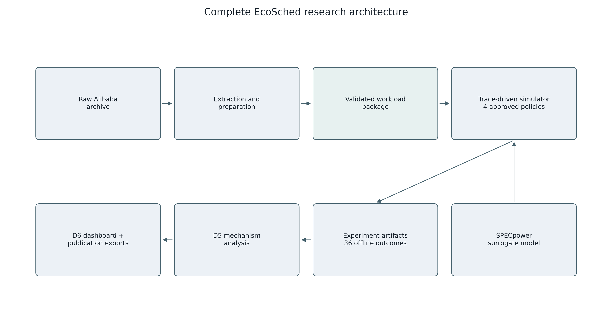
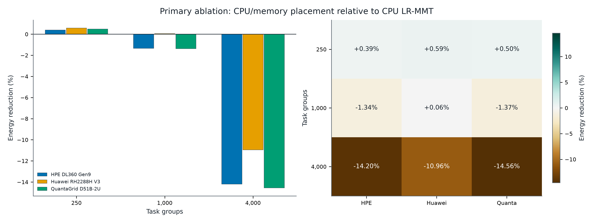
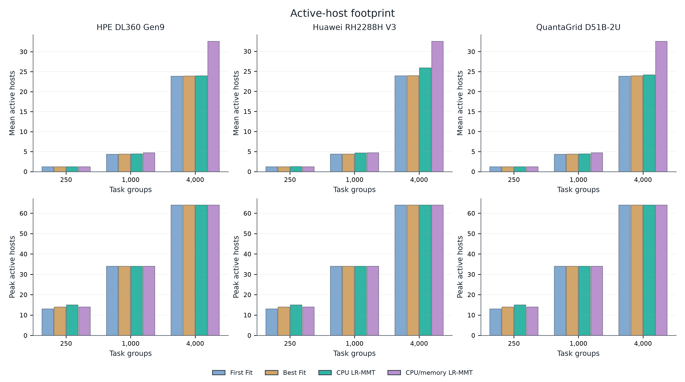
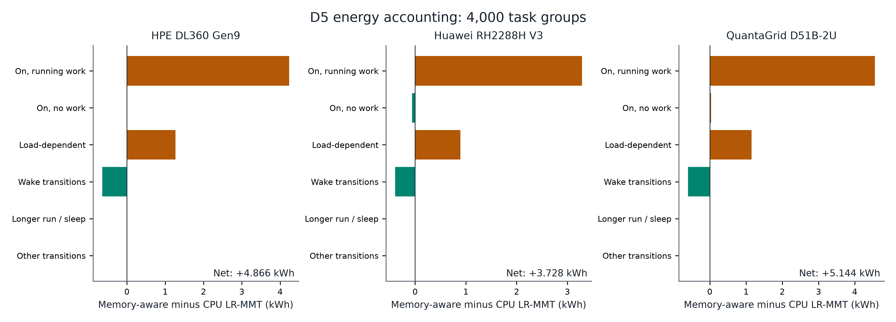
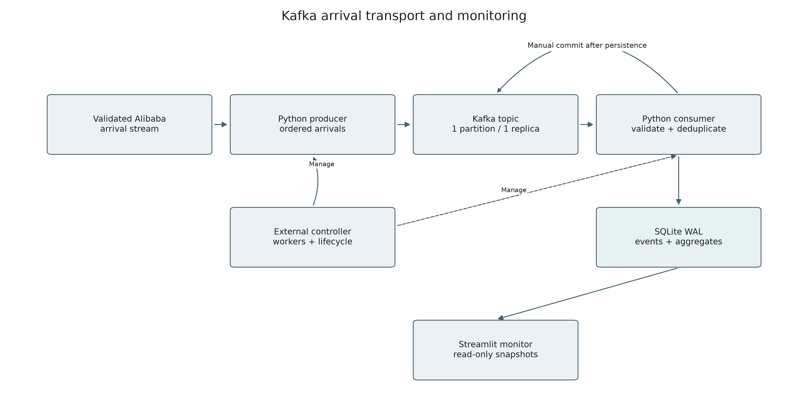
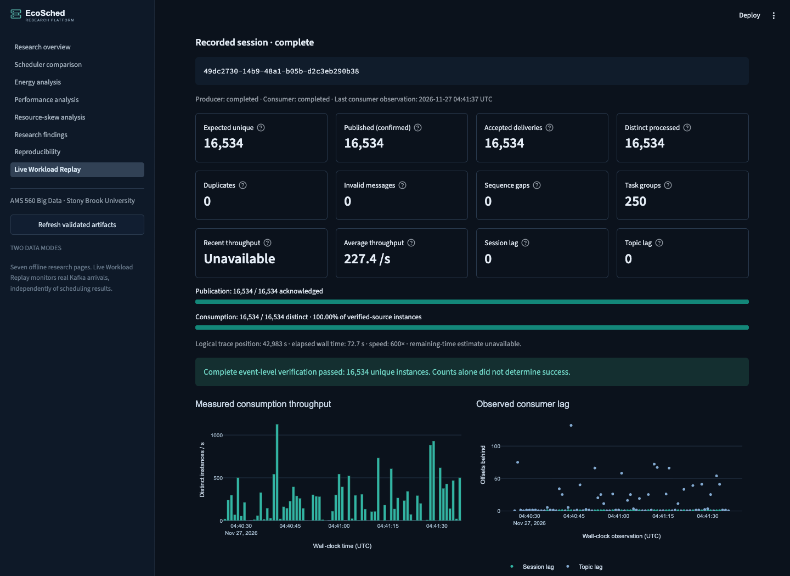
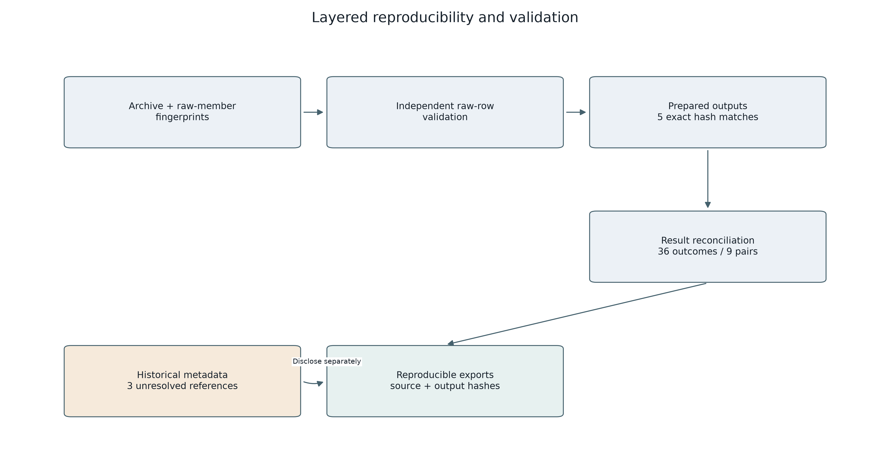

# EcoSched: A Trace-Driven Evaluation of CPU and Memory-Aware Energy-Efficient Data Center Scheduling

Team: Arnav Desai, Brave Desai, Rohan Rane, Rushi Jhala, Yaksh Gandhi

## Page 1: EcoSched

A Trace-Driven Evaluation of CPU and Memory-Aware Energy-Efficient Data Center Scheduling

AMS 560 Big Data | Stony Brook University

Arnav Desai · Brave Desai · Rohan Rane · Rushi Jhala · Yaksh Gandhi

Final research report · D6 integrated package

Research scope: First Fit, Best Fit, CPU-oriented LR-MMT and LR-MMT with CPU/memory-aware placement. The primary ablation changes placement only.

The findings do not establish consistent energy savings. The live system demonstrates authentic workload-arrival transport, independently of the offline scheduling evaluation.

Repository: https://github.com/ai-calypse/Ecoshed · branch arnav/d6-final-package. D6 changes are uncommitted at packaging time. Student identification numbers are intentionally omitted.

## Page 2: Abstract and reading guide

### Abstract

Data center consolidation can reduce the cost of keeping lightly loaded servers powered, but multi-resource placement creates competing objectives. EcoSched investigates whether CPU/memory-aware placement improves modeled energy efficiency relative to CPU-oriented local-regression/minimum-migration-time (LR-MMT) scheduling under otherwise identical conditions. We independently prepare Alibaba cluster-trace-v2017 batch observations using seed 2026, preserve task multiplicity and individual observed durations, and select a fixed 64-host pool. Four policies are evaluated at three workload sizes under three separately applied SPECpower curves, producing 36 active deterministic outcomes and 9 primary paired comparisons. The proposed placement adds a CPU/memory imbalance penalty to normalized incremental power while sharing overload detection, migration selection, admission and simulation mechanics with the CPU baseline. Memory-aware placement saves energy in 4 of 9 comparisons, but consumes 10.96–14.56% more modeled energy at the largest workload. Modest waiting-time and reservation-pressure improvements accompany a larger powered-host footprint. Existing decision recordings and energy decomposition explain how the imbalance term can favor spreading work across already powered hosts. A separate engineering demonstration transports authentic Alibaba arrivals through Apache Kafka with ordered publication, idempotent SQLite persistence and event-level verification; it does not execute a live scheduler. Exact recovered input fingerprints and numerical consistency support inspection, while three historical metadata references remain unresolved. The study contributes a controlled negative result, an explainable energy/performance trade-off and an auditable final research package.

### Report organization

Sections 1–4 establish motivation, related work, the research gap and architecture. Sections 5–8 define data construction, implementation-specific scheduling, energy modeling and experimental controls. Sections 9–10 present the results and D5 mechanism analysis. Sections 11–13 describe the dashboard/Kafka implementation, transport evaluation and layered reproducibility. Sections 14–17 close with limitations, conclusions, individual contributions and references. Appendices A–D provide complete numerical tables, fingerprints, configurations, schema and execution commands.

Layout note: landscape pages retain readable multi-panel figures. Appendix-style A3 foldouts retain dense Pareto and category evidence without shrinking labels excessively. Figure identifiers R/S/A and table identifiers T refer to the immutable Phase 6 publication catalog.

## Page 3: 1. Introduction and 2. Related work

### 1. Introduction

A server incurs a substantial power cost while switched on even when its requested workload is small. Consolidating compatible work can allow other hosts to sleep, but packing too aggressively can increase queueing, resource pressure or migration overhead. CPU and memory constraints complicate this decision: spare CPU on one machine is not useful to a memory-limited request if that machine has insufficient memory. A placement rule that balances resource fractions may reduce one kind of fragmentation while preventing machines from emptying and sleeping. This conflict motivates an explicit energy/performance evaluation rather than treating balanced occupancy as an energy objective.

EcoSched asks whether CPU/memory-aware placement improves modeled energy efficiency relative to CPU-oriented LR-MMT while maintaining acceptable performance on identical Alibaba-derived workloads. Acceptability is assessed descriptively through waiting, pressure and migration outcomes; the project does not define or validate an application-level SLA. The contributions combine deterministic trace construction, common simulation and energy accounting, a controlled placement ablation, separate workload/power sensitivities, existing D5 mechanism analysis, and a reproducible dashboard/transport package.

### 2. Related work

Beloglazov and Buyya [1] study online VM consolidation and adaptive heuristics, including local-regression host overload detection and minimum-migration-time VM selection. Their energy/performance setting motivates separating detection, selection and placement decisions. EcoSched borrows this decomposition but independently adapts it to FIFO batch instances and request reservations; it is not a bit-for-bit reproduction of CloudSim or a replication of their PlanetLab evaluation.

Tetris [2] studies multi-resource task packing across CPU, memory, disk and network. It establishes why one resource dimension can hide packing opportunities in another. EcoSched considers CPU and memory feasibility plus a balance term, without implementing Tetris’s dot-product packing, demand-estimation or job-level prioritization methods.

Li, Shen, Xi and Xiao [3] combine multi-resource consolidation with learned workload prediction and cost objectives involving energy, migration and SLA penalties. EcoSched does not reproduce their predictive model or cost function; its narrower contribution holds the controller fixed and changes placement alone. Alibaba supplies production-derived observations [4], while SPECpower supplies independent whole-server power measurements [5–7]. Neither source directly measures electricity consumed by the simulated Alibaba mini-cluster.

## Page 4: 3. Research gap and 4. System architecture

### 3. Controlled placement ablation

The research gap is an isolated, explainable comparison: does adding explicit CPU/memory balance to incremental-power placement help when all other primary-pair controls remain identical? The hypothesis is plausible because complementary requests could reduce stranded resources. Its counter-hypothesis is equally important: balancing many powered hosts may lower packing density and raise baseline power. The experiment preserves both possibilities and retains adverse outcomes.

The primary pair shares the same workload, fixed host pool, FIFO admission, overload detector, MMT selector, migration conversion, power curve, sleep/wake model and stopping rule. First Fit and Best Fit are useful additional baselines, but their comparison also changes consolidation behavior and is not the placement-only ablation.

### 4. Architecture and module contracts

RAW_Alibaba.extract/prepare/verify_data establish the active inputs and independently validate source rows. RAW_Alibaba.data streams task instances into ecosched.engine; ROHAN_Task.policies supplies placement and controller decisions. ecosched.power interpolates the chosen curve. BASELINE_Comparison.build selects the active result grid. RUSHI_Task observes decisions and decomposes energy; ARNAV_Task validates artifacts, restores inputs, monitors Kafka arrivals and exports publication/final documents. Offline research can be inspected without the runtime archive, prepared CSVs or Kafka.

## Page 5: 5. Dataset and preprocessing

The source is Alibaba cluster-trace-v2017. Its six tables cover batch tasks/attempts, machine events/usage and online-container events/usage. The active evaluation uses server_event.csv for capacities, batch_task.csv for requests, task creation and multiplicity, and batch_instance.csv for eligible observed durations. Other member fingerprints are corroborating archive evidence; online usage is not added as hidden background load. The publisher describes a mixed production trace with different event/usage coverage windows [4]. EcoSched explicitly restricts task creation and eligible completion to the configured 12-hour window.

Table 1 (T02). Active sampled task groups and individual-instance composition.
| Task groups | Individual instances | Balanced | Memory-heavy | CPU-heavy |
| --- | --- | --- | --- | --- |
| 250 | 16534 | 15217 | 1317 | 0 |
| 1000 | 68457 | 52062 | 16297 | 98 |
| 4000 | 378285 | 303807 | 73730 | 748 |
Seed 2026 selects a fixed 64-host pool from valid add records. Capacity classes use physical CPU and rounded normalized memory; each class is represented before the remainder is filled by deterministic hash rank. Hosts retain source-row pointers. The workload samples contain 16,534, 68,457 and 378,285 independently schedulable instances. A group is not treated as a single enlarged request or gang-scheduled job.

Terminated task rows require unique join keys, positive original requests/counts, valid window bounds and feasibility on at least one host. CPU request values are divided by 100, following the active pipeline and Alibaba clarification [4]; memory remains normalized rather than being labeled GB. Eligible instance rows are completed first attempts on known machines, with valid positive durations bounded by the parent task. Optional empirical usage fields are neither imputed nor treated as zero.

A task group is retained only when exactly its declared multiplicity has valid observations. Each instance keeps its own observed end-minus-start duration, rather than a group mean. Duration is engine-private execution input and is absent from policy views and Kafka arrival events. IDs such as raw_attempt_row_123 are stable source-row identities, not recovered original production instance identifiers.

## Page 6: 5.1 Deterministic sampling, releases and recovery

Sampling uses quotas over 900-second arrival bins, resource-skew categories and multiplicity bands. SHA-256 ranks make tie handling deterministic; no energy results influence selection. Group quotas preserve the declared method, not identical instance-weighted burst distributions. Because samples can overlap and come from the same selected window, larger samples are not independent experimental replications.

Resource skew uses the request fractions relative to median host CPU and memory. Let q = (CPU request / median host CPU) / (memory request / median host memory). CPU-heavy means q > 2; memory-heavy means q < 0.5; the remaining observations are balanced. The smallest workload has no CPU-heavy instances. This is a population absence, so category-specific waiting/migration outcomes are unavailable, not zero.

All instances in a task group are released at the original task-create timestamp. The model does not reconstruct original launch staggering, DAG dependencies, gang constraints or scheduler decisions made in production. Individual observed durations begin at the simulated start; queue and wake delays can shift completion beyond the source timestamp. These are declared replay assumptions, not claims of exact production execution.

### 5.2 Active versus historical packages

Yaksh’s earlier D1 handoff uses seed 560 and group-level mean completed duration. It is preserved as historical preparation work, not substituted into the active pipeline. Active RAW_Alibaba uses seed 2026 and complete groups with individual observed durations. Historical ROHAN_Task/BRAVE_Task result reports therefore must not supply active-study kWh or counts. The proposal ownership table is also historical; Section 16 uses actual implementation handoffs and Git evidence.

### 5.3 Independently verified reconstruction

D6 Phase 3 recovered the authentic active archive from an existing local copy, without a new network download. The compressed active archive matches its recorded identity. All 6 extracted raw-member hashes and all 5 reconstructed prepared CSV hashes match the active-study records. Independent validation rereads raw rows, checks original requests, source pointers, arrival bounds, unique identities, complete multiplicity and per-instance duration. A second preparation reproduces the reconstructed package deterministically. The legacy compressed archive differs even where member payloads corroborate; gzip integrity is not a publisher compressed-checksum match. Full hashes appear in Appendix D.

## Page 7: 6. Scheduling algorithms: admission and placement

The engine consumes arrivals in deterministic order and admits requests through a strict FIFO queue. Each placement must fit both physical CPU and normalized-memory capacity. A blocked head is not bypassed by a smaller request. Hosts begin asleep; placing onto a sleeping host reserves capacity and initiates wakeup, while tasks on a waking host wait for its completion. Runtime begins only at actual execution. Equal-time internal events, releases, dispatch, controller sampling and idle-to-sleep handling follow the engine’s documented deterministic ordering.

### 6.1 Additional baseline policies

First Fit chooses the first feasible host in the powered-host-first stable ordering. Best Fit prefers powered hosts and packs the fullest feasible CPU host. Both retain common CPU/memory feasibility and FIFO admission; neither uses the LR/MMT consolidation controller. Consequently differences against these baselines include controller behavior and migration cost, not only scoring.

### 6.2 Primary placement scores

Let uCPU and uMEM be post-placement request fractions on a candidate host. The CPU-oriented score normalizes the incremental steady-state server power. Pbefore uses current active power on powered hosts and modeled sleep watts on sleeping hosts. The memory-aware rule adds the configured imbalance penalty. Both still enforce memory capacity, and stable host identity breaks equal scores.

scoreCPU(h,r) = [P(uCPU_after) − Pbefore(h)] / max(1, Pfull − Pidle)

scoreMEM(h,r) = scoreCPU(h,r) + 0.25 × |uCPU_after − uMEM_after|

The score is a steady-state placement heuristic; actual wake and migration energy are integrated by the engine. A balanced empty host can have a small imbalance penalty even when placing there prevents consolidation elsewhere. These definitions follow LRMMT._score in ROHAN_Task/policies.py. The project heuristic does not implement the complete PABFD sorting procedure, Tetris, or Li et al.’s learned scheduler [1–3].

## Page 8: 6.3 Shared LR/MMT controller and migration safeguards

At each 300-second control tick, both primary variants sample aggregate requested CPU, retaining ten observations per host. Warmup uses a 0.9 CPU threshold. Thereafter a tricube-weighted local straight-line fit extrapolates at least one interval, or enough intervals to cover the largest resident modeled copy time. A 1.2 safety multiplier and forecast threshold at one detect CPU pressure; both variants also apply the same static 0.9 memory guard. Hypothetical additions/removals adjust forecasts relative to the latest sampled load. No future duration, completion or observed utilization is visible to the controller.

On an overloaded host, eligible instances are considered in minimum-memory order with stable instance-ID ties. Common normalized-memory conversion and transfer bandwidth make this equivalent to minimum modeled migration time. Each destination must fit both resources and pass the common pressure guard. Planning stops when pressure is relieved, no safe destination exists or the 256-migration budget is reached.

Underload evacuation applies below 0.3 on both fractions. Hosts are examined in ascending CPU load and residents in descending CPU request. Every resident must fit an already active destination; otherwise the entire tentative evacuation is rolled back. Evacuation does not wake another host. A physical shadow reservation prevents destination overcommit and never credits a source release before copying ends. In-flight/waking allocations are ineligible; transfer endpoints are locked conservatively and migrated instances receive a 600-second cooldown.

For each arrival: enqueue original instance in stable FIFO order
While queue head fits: choose feasible host by selected placement score
At each common control tick:
  observe past/current CPU reservations; forecast overload
  select eligible minimum-memory residents; reserve safe destinations
  plan all-or-nothing underload evacuations onto active recipients
Engine: execute wake/transfer/finish events; release sources at transfer end

Stop-and-copy transfer retains source resources while reserving destination resources. Its duration adds pause to execution; memory uses an assumed 64-GiB-per-normalized-unit conversion and independent 125-MB/s link per transfer. Extra migration watts are configured as zero, but pause, duplicated reservations and delayed sleep still affect modeled energy. These are batch-instance adaptations, not a production hypervisor implementation.

## Page 9: 7. SPECpower energy model

For each host, requested CPU divided by source CPU capacity selects the utilization fraction. The selected HPE DL360 Gen9, Huawei RH2288H V3 or QuantaGrid D51B-2U curve supplies whole-server AC watts [5–7]. Linear interpolation connects adjacent 10%-load points. One curve is applied to every sampled host without scaling by core count or RAM; this is a surrogate sensitivity mapping, not Alibaba hardware calibration.

P(u) = Pi + (Pi+1 − Pi) × (u − ui) / (ui+1 − ui)

EJ = Σhost Σevent interval P(host state, uCPU) × Δt + configured transition extras

EkWh = EJ / 3,600,000;   Wh/instance = 1000 × EkWh / Ncompleted

Reduction (%) = 100 × (Ebaseline − Ecandidate) / Ebaseline

Positive reduction means savings; D5’s energy_change uses candidate minus baseline and has the opposite sign. Active idle is the curve’s zero-load power. Sleep is modeled at 5 W; waking lasts 10 seconds at full-load power. Empty hosts sleep after 60 seconds. Energy integrates exactly over event intervals, including the arrival window and drain. Migration/sleep assumptions are shared, not empirically calibrated. Modeled kWh must not be called measured Alibaba electricity consumption.

## Page 10: 8. Experimental methodology and metric definitions

The active matrix contains four approved policies × three workload sizes × three separately applied power curves = 36 outcomes. The nine primary pairs compare CPU and memory-aware LR-MMT within the same workload and curve, with identical host pool, simulator, controller, runtime and energy assumptions. Every run uses a fresh simulator. The selected samples overlap; the curves are sensitivity conditions, not independent statistical replications. No confidence intervals or significance tests are justified by this design.

Table 2. Operational metric definitions used consistently throughout the report.
| Metric | Definition and interpretation |
| --- | --- |
| Energy / efficiency | Modeled kWh; 1000 × kWh / completed individual instances. |
| Energy reduction | 100 × (baseline − candidate) / baseline; positive means savings. |
| Mean / peak hosts | Time-weighted non-sleeping hosts / maximum non-sleeping hosts. |
| Migration / pause | Completed transfer plans; accumulated pause across instances (instance-seconds). |
| Mean / P95 wait | Initial start minus arrival, including queue and wake delay; separate from migration pause. No averaging P95 quantiles. |
| Reservation pressure | Time above CPU or memory reservation fraction 0.9, divided by host count × simulated duration; modeled SLA proxy. |
| Rejected / unfinished | Instances unable to fit / not completed by the stopping rule; report alongside completed work. |
| Fragmentation | Time-averaged (pooled residual balanced fit − colocated residual fit) / pooled residual fit across powered hosts; zero if no pooled residual fit. |
| Stranded capacity | Time-integrated spare CPU blocked by memory, and spare memory blocked by CPU; core-s and normalized-memory-unit-s. |
| Resource-skew outcome | Category-specific observed instances, waiting quantiles and migrated percentage; primary policies only. |
The full logical arrival window is 43,200 seconds, followed by drain. All offered work completes in the active artifacts, with zero rejected and unfinished instances. This completion evidence supports comparable energy denominators but does not establish an application SLA. Resource pressure uses requested reservations and can include temporary migration reservations. Stranded-capacity thresholds and the pooled-residual fragmentation index are defined in ENERGY_Study/instrumentation.py, reused by RAW_Alibaba; historical ENERGY_Study synthetic results are not evidence.

Results are frozen artifacts, not reruns performed for this report. BASELINE_Comparison.build defines active analysis; ARNAV_Task.analysis cross-checks aggregate copies and individual raw run summaries, normalizes units and excludes historical extensions. Settings and all experimental rows appear in the appendices and Phase 6 T03–T12.

## Page 11: 9. Primary energy results

Table 3 (T09). All primary energy comparisons. Positive reduction indicates savings.
| Groups | Curve | CPU LR-MMT (kWh) | Memory-aware (kWh) | Reduction (%) |
| --- | --- | --- | --- | --- |
| 250 | HPE | 5.217227 | 5.196949 | +0.3887 |
| 250 | Huawei | 5.189138 | 5.158752 | +0.5856 |
| 250 | Quanta | 5.270602 | 5.244489 | +0.4955 |
| 1000 | HPE | 9.032048 | 9.152858 | -1.3376 |
| 1000 | Huawei | 8.969770 | 8.964688 | +0.0567 |
| 1000 | Quanta | 9.230472 | 9.356722 | -1.3677 |
| 4000 | HPE | 34.269962 | 39.136094 | -14.1994 |
| 4000 | Huawei | 34.017004 | 37.745319 | -10.9602 |
| 4000 | Quanta | 35.333163 | 40.477587 | -14.5598 |
The memory-aware variant wins all three 250-group cases and the 1,000-group Huawei case: 4/9 savings cases. It loses both other medium cases and every largest-workload case, where the penalty is 10.96–14.56%. The very small medium Huawei gain is a deterministic observation, not evidence of statistical significance. Negative findings remain visible.

## Page 12: 9.1 Workload and power sensitivity; additional baselines

Table 4 (T08 selection). Energy efficiency uses completed individual instances.
| Groups | Curve | Completed instances | CPU LR-MMT (Wh/instance) | Memory-aware (Wh/instance) |
| --- | --- | --- | --- | --- |
| 250 | HPE | 16534 | 0.315545 | 0.314319 |
| 250 | Huawei | 16534 | 0.313847 | 0.312009 |
| 250 | Quanta | 16534 | 0.318774 | 0.317194 |
| 1000 | HPE | 68457 | 0.131938 | 0.133702 |
| 1000 | Huawei | 68457 | 0.131028 | 0.130954 |
| 1000 | Quanta | 68457 | 0.134836 | 0.136680 |
| 4000 | HPE | 378285 | 0.090593 | 0.103457 |
| 4000 | Huawei | 378285 | 0.089924 | 0.099780 |
| 4000 | Quanta | 378285 | 0.093404 | 0.107003 |
Modeled energy rises with workload size, while Wh per completed instance can decline as more work amortizes host overhead. Different power curves change magnitudes and can reverse a near-zero comparison; no curve is averaged into one physical energy observation. Relative to First Fit and Best Fit, memory-aware LR-MMT saves energy in 2/9 and 3/9 matched cases respectively. This also shows why the primary placement ablation is more controlled than a claim against non-migrating baselines. All four-policy energy/efficiency rows are retained in Appendix A.

## Page 13: 9.2 Active-host footprint

At the largest workload, memory-aware placement keeps more hosts powered on average, even though peak active hosts reach the fixed pool limit. Mean active-host time, rather than the maximum alone, is therefore informative about the energy penalty. The shared baseline power makes additional powered time expensive. These modeled counts are offline simulator outputs; no live Kafka arrival metric is interpreted as an active host.

## Page 14: 9.3 Waiting, migration and completion

Mean waiting changes at the largest workload range from -1.592 to -1.032 seconds, candidate minus CPU LR-MMT. Such modest improvements can accompany the substantially larger energy cost. P95 quantiles remain separate run observations; they are never averaged across samples, curves or categories. Migration counts and accumulated pause are retained in Appendix B/T10/R08: fewer migrations do not imply lower energy when workload spreads across more powered hosts. All active runs complete the same offered instances without rejection or unfinished work.

## Page 15: 9.4 Pressure, fragmentation and interpretation

Lower reservation pressure and a smaller fragmentation index are useful descriptive outcomes, but neither alone defines an energy-efficient scheduler. The pressure fraction is time above a requested-resource threshold, not observed application SLA violations. The fragmentation metric compares pooled residual balanced capacity to what is colocated on individual powered hosts. It can improve when resources are distributed more evenly while powered-host time increases. Time-integrated stranded CPU and memory capacity are exported in T11/R10; those units are not physical memory utilization or completed-work counts.

## Page 16: 10. D5 mechanism analysis: where the penalty arises

Table 5 (T19 selection). Extra on/work energy divided by each curve’s own net energy gap.
| Curve | Net penalty (kWh) | Extra on/work (kWh) | Share of net penalty (%) | Extra on/work (host-h) |
| --- | --- | --- | --- | --- |
| HPE | 4.866132 | 4.237729 | 87.0862 | 105.943 |
| Huawei | 3.728315 | 3.290392 | 88.2541 | 82.673 |
| Quanta | 5.144425 | 4.557833 | 88.5975 | 102.194 |
The share attributed to extra powered time while running work is 87.09% for HPE, 88.25% for Huawei and 88.60% for Quanta. Each denominator is that curve’s own net candidate-minus-baseline kWh gap. D5’s rounded “about 88%” is 87.969% when it sums these components and gaps across scenarios. That pooled descriptive ratio is not one physical energy experiment; this report interprets the separate shares instead.

Additional on-time while idle contributes little to the largest-case gap. Load-dependent power adds a penalty, while fewer wake transitions offset part of it. Thus the evidence does not support a story that the proposed scheduler simply leaves empty servers idle or wakes more machines. D5 observes more simultaneously busy hosts that empty less readily. Its accounting components reconcile to the net gap.

## Page 17: 10.1 Energy/performance trade-offs and descriptive Pareto sets

Each panel minimizes modeled energy and the displayed performance objective inside one 4,000-group/power-curve condition. Dashed connections join observed non-dominated policies only; they are not a continuous feasible frontier. Different objectives preserve different trade-offs, so no global optimality follows. The complete figure uses a foldout page to preserve labels. Placement-score arithmetic and recorded controller/host timelines (R14–R15, T20–T22) provide complementary mechanism evidence rather than independent experimental replications.

## Page 18: 10.2 Resource-skew findings and placement decisions

D5 category outcomes exist only for the primary policies. HPE is displayed without pooling other curves; all 48 observed category outcomes appear in Appendix C. The 250-group CPU-heavy category has no observations, so no wait or migration value is assigned. Whole-run energy is not allocated to resource-skew categories because there is no validated attribution method.

The balance penalty can outweigh the incremental-power preference among hosts already switched on. A small task leaves an empty powered host close to balanced, whereas a busy memory-heavy host incurs imbalance. D5’s illustrative arithmetic and decision recordings support this spreading mechanism. The same balance improvement is usually insufficient to justify the score cost of waking a sleeping host, consistent with fewer wakeups. Counterfactual picks are scored on recorded snapshots, not proof of an alternative full-run outcome. Controller diagnostics share the same implementation and cannot establish universal production causality.

Category-specific wait, P95 and migrated percentages are observed outcomes; a category’s number of instances does not create statistical independence. Population skew is fixed across policies. T20–T22 retain placement and controller evidence; R14 is explicitly a previously recorded simulation timeline.

## Page 19: 11. D6 Kafka and monitoring architecture

Validated arrival events preserve source order, equal-time tie order, stable source-row identity, original group/job IDs, request values and multiplicity. The producer streams one event per instance through the single-partition topic. A monotonic replay clock changes presentation speed without altering logical timestamps. Future duration/completion information is absent. Acknowledged publication is tracked separately from attempted sends and distinct persisted consumption.

The external controller starts the consumer before publication, serializes active-session creation and survives browser refresh or navigation. Consumers validate schema, manifest, sequence, arrival order and identity. SQLite WAL transactions durably store events and aggregates before manual Kafka offset commits. Uniqueness on replay/instance and replay/sequence prevents exact redelivery from inflating distinct counts; conflicting payloads are errors. At-least-once delivery with idempotent persistence is the established guarantee, not distributed exactly-once processing.

## Page 20: 11.1 Dashboard implementation and data separation

The unified artifact adapter exposes the 36 active outcomes without raw/prepared CSVs. Seven offline research pages provide overview, scheduler comparison, energy, performance, resource skew, findings and reproducibility. Shared metric definitions, source references and filters prevent cross-condition baseline comparisons. Plotly charts retain missing observations, energy-reduction signs and provenance disclosures. Explicit refresh is separate from the read-only live state path.

The eighth page, Live Workload Replay, calls the existing external controller rather than starting loops inside Streamlit reruns. Read-only bounded SQLite snapshots expose freshness, worker status, publication/consumption progress, actual consumer throughput, observed offset lag and logical-interval demand. Active fragments refresh approximately every two seconds; historical sessions remain labeled recorded. Confirmed publication counters persist in batches and can temporarily trail consumer observations.

Offered CPU and normalized-memory demand sum arriving requests; they are not allocated resources or server utilization. Topic lag and session-bounded lag can differ. Arrival events alone cannot yield live modeled energy, active hosts, scheduler decisions or SLA outcomes. A session is complete only after the event-level verifier succeeds, not merely when a progress count reaches its target.

## Page 21: 12. Streaming evaluation and recovery evidence

Table 6 (T14 selection). Recorded Phase 4 fast-mode sessions on the single ARM64 broker.
| Groups | Distinct instances | Session time (s) | Distinct instances/s | Verification |
| --- | --- | --- | --- | --- |
| 250 | 16534 | 3.934 | 4202.60 | Full event-level pass |
| 1000 | 68457 | 11.393 | 6008.79 | Full event-level pass |
| 4000 | 378285 | 54.600 | 6928.26 | Full event-level pass |
Verification compares every persisted source-facing event or its deterministic payload stream against the validated source: original identity, sequence, arrival, CPU/memory request, group multiplicity and manifest. All three complete workloads pass. Session wall time includes the controller lifecycle and completion verification; isolated verifier duration was not separately measured. These observations do not establish distributed scalability or scheduler execution speed.

In the recorded duplicate test, accepted deliveries increase from 16,534 to 33,068 while distinct instances remain 16,534. Consumer interruption resumes from persisted offsets and reaches complete source verification. Cancellation remains incomplete; broker unavailability and recovery are tested. The actual Phase 5 browser replay at 600× completes 16,534 unique arrivals in 72.698 s at 227.43 distinct instances/s. Timed and fast-mode runs are separate; browser refresh/navigation preserve session identity. Recorded histories and screenshots are valid fallbacks only when explicitly labeled recorded.

## Page 22: 13. Reproducibility and layered validation

Evidence is layered: compressed active-archive identity, six raw-member matches, five prepared-output matches, independent raw-row validation, recorded source-code fingerprints and numerical result reconciliation. Phase 6 additionally records 167 byte-identical compared publication files across two builds in its pinned environment. Its receipt reflects the documentation state at that build; later D6 documentation edits do not change frozen figures, tables or scheduler results. Phase 6 recorded 307 distinct passing tests. Phase 7 regression receipts are supplied separately in phase7_verification.json; ordinary and real-broker cases are counted once, not added across historical phases.

Three historical references remain unresolved: expected prepared-manifest hash 110e6497… versus committed 91de65a6…; expected raw-summary hash b64f374f… versus 479d3c44…; expected archive-audit hash 711dc211… versus 03179510…. No earlier matching versions were recovered in the searched Git history. Exact reconstructed input-file identity does not recreate those historical metadata bytes. Hashes are not overwritten merely to pass validation. Numerical inspection remains usable, but full historical lineage and fresh full-matrix simulation reproduction are not claimed. Appendix D records exact hashes, schema and commands.

## Page 23: 14. Limitations; 15. Conclusion; 16. Contributions

### 14. Scientific and systems limitations

Complete first-attempt and window filtering introduce selection/boundary bias. Samples overlap, share one selected host pool and are not independent replications. Task-create release omits production launch staggering, DAG and gang behavior. Demand is constant requested capacity, not measured per-instance usage. Online background load, source failures and production dependencies are not replayed. SPECpower mapping lacks hardware calibration; migration bandwidth, normalized-memory conversion and sleep/wake states are assumptions. Reservation pressure is an SLA proxy. Category outcomes are limited to supported policies; absent categories do not support zero-valued claims. Historical metadata lineage is unresolved. Kafka uses one local broker, no high availability and at-least-once transport; laptop throughput does not establish distributed scalability.

### 15. Conclusion and future work

Memory-aware placement saves energy in 4/9 cases but incurs 10.96–14.56% penalties at the largest workload while improving some waiting/pressure measures. Balanced resource fractions are therefore insufficient as an energy objective. Future work should freeze placement settings before evaluating independent Alibaba windows, calibrate power and migration assumptions, study balance weights with held-out samples, and establish real application-performance constraints. Such work is proposed, not completed. Kafka is an engineering demonstration, not the scheduling novelty.

### 16. Individual contributions and attribution

Table 7 (T18). Directory ownership/documentation establishes implementation credit; imported Git authorship can differ.
| Member | Implementation credit and repository evidence |
| --- | --- |
| Yaksh Gandhi | D1 historical verified data package, sampling and handoff; commits bb176f4, d307337. Historical seed 560 package is not substituted for active inputs. |
| Brave Desai | D2 event simulator and SPECpower model; active RAW_Alibaba preparation, instrumentation and D4 integration. Commit 320da27; PR #1 merged in 938af17. |
| Rohan Rane | D3 policies and shared LR/MMT consolidation, documented in ROHAN_Task. Imported in Brave-authored integration commit 320da27; module ownership and Git authorship differ. |
| Rushi Jhala | D5 observer, accounting, placement diagnostics, skew analysis and research report. Active analysis commit 8fba308; PR #2 merged in b0c4828. Later same-job results excluded. |
| Arnav Desai | D6 artifact/metric validation, dashboard, exact input recovery, Kafka workers/controller/state, live monitoring, publication assets and this final report/deck/runbook. D6 working tree is uncommitted; no commit authorship is invented. |

## Page 24: 17. References

[1] A. Beloglazov and R. Buyya. Optimal Online Deterministic Algorithms and Adaptive Heuristics for Energy and Performance Efficient Dynamic Consolidation of Virtual Machines in Cloud Data Centers. Concurrency and Computation: Practice and Experience 24(13), 1397–1420 (2012). DOI: 10.1002/cpe.1867. https://beloglazov.info/papers/2012-optimal-algorithms-ccpe.pdf

[2] R. Grandl, G. Ananthanarayanan, S. Kandula, S. Rao and A. Akella. Multi-Resource Packing for Cluster Schedulers. Proceedings of ACM SIGCOMM 2014, 455–466. DOI: 10.1145/2619239.2626334. https://people.csail.mit.edu/alizadeh/papers/tetris.pdf

[3] H. Li, Y. Shen, H. Xi and Y. Xiao. Complementary in Time and Space: Optimization on Cost and Performance with Multiple Resources Usage by Server Consolidation in Cloud Data Center. Applied Sciences 12(19), 9654 (2022). DOI: 10.3390/app12199654. https://www.mdpi.com/2076-3417/12/19/9654

[4] Alibaba Group. Alibaba Cluster Trace Program: cluster-trace-v2017 (2017). Official schema and trace documentation; implementation follows the documented CPU-unit clarification in issue #11. https://github.com/alibaba/clusterdata/tree/master/cluster-trace-v2017

[5] Standard Performance Evaluation Corporation. SPECpower_ssj2008 result 20151215-00708: HPE ProLiant DL360 Gen9. Published 2016-01-07. Whole-server AC power at target load levels. https://www.spec.org/power_ssj2008/results/res2016q1/power_ssj2008-20151215-00708.html

[6] Standard Performance Evaluation Corporation. SPECpower_ssj2008 result 20150829-00703: Huawei Fusion Server RH2288H V3. Published 2015-09-25. Whole-server AC power at target load levels. https://www.spec.org/power_ssj2008/results/res2015q3/power_ssj2008-20150829-00703.html

[7] Standard Performance Evaluation Corporation. SPECpower_ssj2008 result 20141124-00679: QuantaGrid D51B-2U. Published 2014-12-10. Whole-server AC power at target load levels. https://www.spec.org/power_ssj2008/results/res2014q4/power_ssj2008-20141124-00679.html

[8] Apache Software Foundation. Apache Kafka 4.4 documentation: design, consumer offsets and KRaft operation. https://kafka.apache.org/44/documentation/

[9] Streamlit. Official documentation: multipage applications, fragments and application testing. https://docs.streamlit.io/

[10] Plotly Technologies. Plotly Python graphing library documentation. https://plotly.com/python/

[11] SQLite. Write-Ahead Logging and transaction documentation. https://sqlite.org/wal.html

[12] EcoSched team. Ecoshed repository: active implementation, configurations, raw-derived outcomes, D5 analysis and D6 verification receipts. Git base b0c48284; D6 uncommitted. https://github.com/ai-calypse/Ecoshed

Bibliographic metadata was checked against the original author manuscript, publisher record, official dataset repository and SPEC result pages. The Tetris citation uses the conference DOI printed in the original paper, not an alternate journal-container DOI. Software references identify implementation tools; they are not evidence for experimental energy savings. Full bibliography source is included as references.bib.

## Page 25: Appendix A. Complete energy and efficiency results

Table A1 (T07–T08). Every active policy/size/curve outcome; no physical pooling across curves.
| Groups | Curve | Policy | Completed | Energy (kWh) | Wh/instance |
| --- | --- | --- | --- | --- | --- |
| 250 | HPE | First Fit | 16534 | 5.196158 | 0.314271 |
| 250 | HPE | Best Fit | 16534 | 5.202633 | 0.314663 |
| 250 | HPE | CPU LR-MMT | 16534 | 5.217227 | 0.315545 |
| 250 | HPE | CPU/memory LR-MMT | 16534 | 5.196949 | 0.314319 |
| 250 | Huawei | First Fit | 16534 | 5.160144 | 0.312093 |
| 250 | Huawei | Best Fit | 16534 | 5.166418 | 0.312472 |
| 250 | Huawei | CPU LR-MMT | 16534 | 5.189138 | 0.313847 |
| 250 | Huawei | CPU/memory LR-MMT | 16534 | 5.158752 | 0.312009 |
| 250 | Quanta | First Fit | 16534 | 5.248996 | 0.317467 |
| 250 | Quanta | Best Fit | 16534 | 5.255867 | 0.317882 |
| 250 | Quanta | CPU LR-MMT | 16534 | 5.270602 | 0.318774 |
| 250 | Quanta | CPU/memory LR-MMT | 16534 | 5.244489 | 0.317194 |
| 1000 | HPE | First Fit | 68457 | 8.975435 | 0.131111 |
| 1000 | HPE | Best Fit | 68457 | 8.995054 | 0.131397 |
| 1000 | HPE | CPU LR-MMT | 68457 | 9.032048 | 0.131938 |
| 1000 | HPE | CPU/memory LR-MMT | 68457 | 9.152858 | 0.133702 |
| 1000 | Huawei | First Fit | 68457 | 8.797097 | 0.128505 |
| 1000 | Huawei | Best Fit | 68457 | 8.815802 | 0.128779 |
| 1000 | Huawei | CPU LR-MMT | 68457 | 8.969770 | 0.131028 |
| 1000 | Huawei | CPU/memory LR-MMT | 68457 | 8.964688 | 0.130954 |
| 1000 | Quanta | First Fit | 68457 | 9.158216 | 0.133781 |
| 1000 | Quanta | Best Fit | 68457 | 9.179279 | 0.134088 |
| 1000 | Quanta | CPU LR-MMT | 68457 | 9.230472 | 0.134836 |
| 1000 | Quanta | CPU/memory LR-MMT | 68457 | 9.356722 | 0.136680 |
| 4000 | HPE | First Fit | 378285 | 34.151822 | 0.090281 |
| 4000 | HPE | Best Fit | 378285 | 34.198514 | 0.090404 |
| 4000 | HPE | CPU LR-MMT | 378285 | 34.269962 | 0.090593 |
| 4000 | HPE | CPU/memory LR-MMT | 378285 | 39.136094 | 0.103457 |
| 4000 | Huawei | First Fit | 378285 | 32.828993 | 0.086784 |
| 4000 | Huawei | Best Fit | 378285 | 32.870935 | 0.086895 |
| 4000 | Huawei | CPU LR-MMT | 378285 | 34.017004 | 0.089924 |
| 4000 | Huawei | CPU/memory LR-MMT | 378285 | 37.745319 | 0.099780 |
| 4000 | Quanta | First Fit | 378285 | 35.036588 | 0.092620 |
| 4000 | Quanta | Best Fit | 378285 | 35.085098 | 0.092748 |
| 4000 | Quanta | CPU LR-MMT | 378285 | 35.333163 | 0.093404 |
| 4000 | Quanta | CPU/memory LR-MMT | 378285 | 40.477587 | 0.107003 |
All 36 outcomes report zero rejected and unfinished instances. Completed-instance replays across policies and curves total 5,559,312; this is repeated experimental execution, not that many distinct source instances. CSV exports retain full precision; display values here are rounded. Configuration and source hashes are recorded with each authoritative run.

## Page 26: Appendix B. Complete host, migration and waiting results

Table B1 (T10–T11 selection). Individual-run outcomes. Pressure is a modeled reservation/SLA proxy; P95 values are never averaged.
| Groups | Curve | Policy | Mean hosts | Peak hosts | Migrations | Pause (instance-s) | Mean wait (s) | P95 wait (s) | Pressure fraction | Fragmentation |
| --- | --- | --- | --- | --- | --- | --- | --- | --- | --- | --- |
| 250 | HPE | First Fit | 1.210 | 13 | 0 | 0.00 | 8.454 | 10.0 | 0.004325 | 0.000332 |
| 250 | HPE | Best Fit | 1.218 | 14 | 0 | 0.00 | 8.482 | 10.0 | 0.004426 | 0.000332 |
| 250 | HPE | CPU LR-MMT | 1.234 | 15 | 275 | 2336.36 | 8.421 | 10.0 | 0.003730 | 0.000236 |
| 250 | HPE | CPU/memory LR-MMT | 1.195 | 14 | 276 | 2607.39 | 8.404 | 10.0 | 0.003180 | 0.000209 |
| 250 | Huawei | First Fit | 1.210 | 13 | 0 | 0.00 | 8.454 | 10.0 | 0.004325 | 0.000332 |
| 250 | Huawei | Best Fit | 1.218 | 14 | 0 | 0.00 | 8.482 | 10.0 | 0.004426 | 0.000332 |
| 250 | Huawei | CPU LR-MMT | 1.250 | 15 | 307 | 2462.41 | 8.421 | 10.0 | 0.003725 | 0.000236 |
| 250 | Huawei | CPU/memory LR-MMT | 1.195 | 14 | 276 | 2607.39 | 8.404 | 10.0 | 0.003179 | 0.000209 |
| 250 | Quanta | First Fit | 1.210 | 13 | 0 | 0.00 | 8.454 | 10.0 | 0.004325 | 0.000332 |
| 250 | Quanta | Best Fit | 1.218 | 14 | 0 | 0.00 | 8.482 | 10.0 | 0.004426 | 0.000332 |
| 250 | Quanta | CPU LR-MMT | 1.234 | 15 | 275 | 2336.36 | 8.421 | 10.0 | 0.003731 | 0.000236 |
| 250 | Quanta | CPU/memory LR-MMT | 1.194 | 14 | 276 | 2607.39 | 8.404 | 10.0 | 0.003180 | 0.000209 |
| 1000 | HPE | First Fit | 4.355 | 34 | 0 | 0.00 | 5.662 | 10.0 | 0.021179 | 0.003747 |
| 1000 | HPE | Best Fit | 4.375 | 34 | 0 | 0.00 | 5.676 | 10.0 | 0.021387 | 0.003999 |
| 1000 | HPE | CPU LR-MMT | 4.423 | 34 | 1634 | 12702.14 | 5.677 | 10.0 | 0.018262 | 0.003158 |
| 1000 | HPE | CPU/memory LR-MMT | 4.722 | 34 | 1482 | 11493.31 | 5.095 | 10.0 | 0.014421 | 0.003032 |
| 1000 | Huawei | First Fit | 4.355 | 34 | 0 | 0.00 | 5.662 | 10.0 | 0.021179 | 0.003747 |
| 1000 | Huawei | Best Fit | 4.375 | 34 | 0 | 0.00 | 5.676 | 10.0 | 0.021387 | 0.003999 |
| 1000 | Huawei | CPU LR-MMT | 4.653 | 34 | 1746 | 13030.47 | 5.346 | 10.0 | 0.017822 | 0.002524 |
| 1000 | Huawei | CPU/memory LR-MMT | 4.715 | 34 | 1443 | 11794.00 | 5.056 | 10.0 | 0.014549 | 0.004360 |
| 1000 | Quanta | First Fit | 4.355 | 34 | 0 | 0.00 | 5.662 | 10.0 | 0.021179 | 0.003747 |
| 1000 | Quanta | Best Fit | 4.375 | 34 | 0 | 0.00 | 5.676 | 10.0 | 0.021387 | 0.003999 |
| 1000 | Quanta | CPU LR-MMT | 4.440 | 34 | 1540 | 12591.39 | 5.678 | 10.0 | 0.018105 | 0.003145 |
| 1000 | Quanta | CPU/memory LR-MMT | 4.737 | 34 | 1469 | 11937.03 | 5.102 | 10.0 | 0.014533 | 0.002946 |
| 4000 | HPE | First Fit | 23.867 | 64 | 0 | 0.00 | 55.959 | 465.0 | 0.196246 | 0.023673 |
| 4000 | HPE | Best Fit | 23.926 | 64 | 0 | 0.00 | 56.028 | 465.0 | 0.198003 | 0.021540 |
| 4000 | HPE | CPU LR-MMT | 23.968 | 64 | 7695 | 64496.10 | 56.062 | 466.0 | 0.184662 | 0.019838 |
| 4000 | HPE | CPU/memory LR-MMT | 32.606 | 64 | 7222 | 53022.16 | 54.470 | 465.0 | 0.140692 | 0.008615 |
| 4000 | Huawei | First Fit | 23.867 | 64 | 0 | 0.00 | 55.959 | 465.0 | 0.196246 | 0.023673 |
| 4000 | Huawei | Best Fit | 23.926 | 64 | 0 | 0.00 | 56.028 | 465.0 | 0.198003 | 0.021540 |
| 4000 | Huawei | CPU LR-MMT | 25.859 | 64 | 9103 | 70617.45 | 55.588 | 466.0 | 0.172556 | 0.015911 |
| 4000 | Huawei | CPU/memory LR-MMT | 32.496 | 64 | 7095 | 51170.53 | 54.557 | 465.0 | 0.140201 | 0.011164 |
| 4000 | Quanta | First Fit | 23.867 | 64 | 0 | 0.00 | 55.959 | 465.0 | 0.196246 | 0.023673 |
| 4000 | Quanta | Best Fit | 23.926 | 64 | 0 | 0.00 | 56.028 | 465.0 | 0.198003 | 0.021540 |
| 4000 | Quanta | CPU LR-MMT | 24.183 | 64 | 7337 | 63153.22 | 55.991 | 465.0 | 0.178692 | 0.019262 |
| 4000 | Quanta | CPU/memory LR-MMT | 32.572 | 64 | 7138 | 52007.78 | 54.479 | 465.0 | 0.141207 | 0.010038 |
Pause is accumulated instance-seconds. Fragmentation uses the time-averaged pooled-residual packing-opportunity index, not |CPU − memory|. Stranded capacity uses memory ≥ 0.9 with CPU ≤ 0.5 (and the symmetric CPU/memory condition), integrating actual remaining capacity. Full stranded-capacity values are preserved in T11 and R10. These diagnostics do not replace energy, completion and initial waiting outcomes.

## Page 27: Appendix C. Complete supported resource-skew outcomes

Table C1 (T12). All 48 observed primary-policy category outcomes; six absent 250-group CPU-heavy combinations are not assigned outcomes.
| Groups | Curve | Policy | Category | Instances | Mean wait (s) | P95 wait (s) | Delayed (%) | Migrated (%) |
| --- | --- | --- | --- | --- | --- | --- | --- | --- |
| 250 | HPE | CPU LR-MMT | balanced | 15217 | 8.522 | 10.0 | 85.312 | 1.781 |
| 250 | HPE | CPU LR-MMT | memory heavy | 1317 | 7.251 | 10.0 | 72.513 | 0.304 |
| 250 | HPE | CPU/memory LR-MMT | balanced | 15217 | 8.474 | 10.0 | 84.826 | 1.735 |
| 250 | HPE | CPU/memory LR-MMT | memory heavy | 1317 | 7.601 | 10.0 | 76.006 | 0.911 |
| 1000 | HPE | CPU LR-MMT | balanced | 52062 | 5.438 | 10.0 | 54.911 | 2.038 |
| 1000 | HPE | CPU LR-MMT | cpu heavy | 98 | 1.020 | 10.0 | 10.204 | 15.306 |
| 1000 | HPE | CPU LR-MMT | memory heavy | 16297 | 6.469 | 10.0 | 64.705 | 3.424 |
| 1000 | HPE | CPU/memory LR-MMT | balanced | 52062 | 4.908 | 10.0 | 49.723 | 1.857 |
| 1000 | HPE | CPU/memory LR-MMT | cpu heavy | 98 | 1.020 | 10.0 | 10.204 | 12.245 |
| 1000 | HPE | CPU/memory LR-MMT | memory heavy | 16297 | 5.716 | 10.0 | 57.201 | 3.086 |
| 4000 | HPE | CPU LR-MMT | balanced | 303807 | 53.331 | 112.0 | 52.789 | 1.434 |
| 4000 | HPE | CPU LR-MMT | cpu heavy | 748 | 53.720 | 8.0 | 12.701 | 13.636 |
| 4000 | HPE | CPU LR-MMT | memory heavy | 73730 | 67.339 | 523.0 | 41.809 | 4.378 |
| 4000 | HPE | CPU/memory LR-MMT | balanced | 303807 | 51.781 | 110.0 | 38.478 | 1.408 |
| 4000 | HPE | CPU/memory LR-MMT | cpu heavy | 748 | 53.492 | 7.0 | 11.765 | 11.497 |
| 4000 | HPE | CPU/memory LR-MMT | memory heavy | 73730 | 65.559 | 521.0 | 25.229 | 3.865 |
| 250 | Huawei | CPU LR-MMT | balanced | 15217 | 8.522 | 10.0 | 85.312 | 1.952 |
| 250 | Huawei | CPU LR-MMT | memory heavy | 1317 | 7.251 | 10.0 | 72.513 | 0.759 |
| 250 | Huawei | CPU/memory LR-MMT | balanced | 15217 | 8.474 | 10.0 | 84.826 | 1.735 |
| 250 | Huawei | CPU/memory LR-MMT | memory heavy | 1317 | 7.601 | 10.0 | 76.006 | 0.911 |
| 1000 | Huawei | CPU LR-MMT | balanced | 52062 | 5.061 | 10.0 | 51.076 | 2.182 |
| 1000 | Huawei | CPU LR-MMT | cpu heavy | 98 | 1.020 | 10.0 | 10.204 | 18.367 |
| 1000 | Huawei | CPU LR-MMT | memory heavy | 16297 | 6.283 | 10.0 | 62.846 | 3.633 |
| 1000 | Huawei | CPU/memory LR-MMT | balanced | 52062 | 4.876 | 10.0 | 49.406 | 1.794 |
| 1000 | Huawei | CPU/memory LR-MMT | cpu heavy | 98 | 1.020 | 10.0 | 10.204 | 12.245 |
| 1000 | Huawei | CPU/memory LR-MMT | memory heavy | 16297 | 5.655 | 10.0 | 56.587 | 3.050 |
| 4000 | Huawei | CPU LR-MMT | balanced | 303807 | 52.895 | 110.0 | 48.102 | 1.737 |
| 4000 | Huawei | CPU LR-MMT | cpu heavy | 748 | 53.651 | 8.0 | 12.166 | 11.898 |
| 4000 | Huawei | CPU LR-MMT | memory heavy | 73730 | 66.704 | 523.0 | 35.363 | 5.064 |
| 4000 | Huawei | CPU/memory LR-MMT | balanced | 303807 | 51.872 | 110.0 | 39.054 | 1.391 |
| 4000 | Huawei | CPU/memory LR-MMT | cpu heavy | 748 | 53.512 | 7.0 | 11.364 | 12.701 |
| 4000 | Huawei | CPU/memory LR-MMT | memory heavy | 73730 | 65.628 | 523.0 | 25.421 | 3.754 |
| 250 | Quanta | CPU LR-MMT | balanced | 15217 | 8.522 | 10.0 | 85.312 | 1.781 |
| 250 | Quanta | CPU LR-MMT | memory heavy | 1317 | 7.251 | 10.0 | 72.513 | 0.304 |
| 250 | Quanta | CPU/memory LR-MMT | balanced | 15217 | 8.474 | 10.0 | 84.826 | 1.735 |
| 250 | Quanta | CPU/memory LR-MMT | memory heavy | 1317 | 7.601 | 10.0 | 76.006 | 0.911 |
| 1000 | Quanta | CPU LR-MMT | balanced | 52062 | 5.441 | 10.0 | 54.935 | 1.854 |
| 1000 | Quanta | CPU LR-MMT | cpu heavy | 98 | 1.020 | 10.0 | 10.204 | 15.306 |
| 1000 | Quanta | CPU LR-MMT | memory heavy | 16297 | 6.462 | 10.0 | 64.638 | 3.436 |
| 1000 | Quanta | CPU/memory LR-MMT | balanced | 52062 | 4.920 | 10.0 | 49.848 | 1.825 |
| 1000 | Quanta | CPU/memory LR-MMT | cpu heavy | 98 | 1.020 | 10.0 | 10.204 | 12.245 |
| 1000 | Quanta | CPU/memory LR-MMT | memory heavy | 16297 | 5.707 | 10.0 | 57.109 | 3.111 |
| 4000 | Quanta | CPU LR-MMT | balanced | 303807 | 53.273 | 112.0 | 52.334 | 1.322 |
| 4000 | Quanta | CPU LR-MMT | cpu heavy | 748 | 53.707 | 8.0 | 12.299 | 13.770 |
| 4000 | Quanta | CPU LR-MMT | memory heavy | 73730 | 67.215 | 523.0 | 40.745 | 4.356 |
| 4000 | Quanta | CPU/memory LR-MMT | balanced | 303807 | 51.776 | 110.0 | 38.471 | 1.425 |
| 4000 | Quanta | CPU/memory LR-MMT | cpu heavy | 748 | 53.338 | 3.0 | 9.358 | 9.759 |
| 4000 | Quanta | CPU/memory LR-MMT | memory heavy | 73730 | 65.631 | 522.0 | 26.079 | 3.701 |
Category classification is fixed by the prepared workload, relative to median host capacities. Population counts are in Table 1. No First Fit/Best Fit category outcomes or category-attributed energy are inferred. Percent migrated means an instance migrated at least once; it is not the number of transfer operations. Full missing-category rows with explicit No observations status remain in the machine-readable T12 export.

## Page 28: Appendix D. Fingerprints, configuration, schema and commands

Active compressed archive: `b7efe9dc9caa75352de41b9ac34b329602cde3414fd7cab87c1d21a9a9871d66`

Legacy compressed archive (different): `02c1fbc412fccc03b748c05ec18fc30fd93c0bc383eea47ac21146c4aa2235df`

batch_instance.csv: `195f25ef36484a2da9bb92c08e203224ed34a32f48fcbe11c01d94ecf308d817`

batch_task.csv: `50f3c50ab4a917ad06c1cee6ec601e1356708774d7962503e8eafdd720b2286d`

container_event.csv: `8e2c2776983fb0867f5088352849773186eab22de9d878e10978b5018c68aeda`

container_usage.csv: `9ccb7abafdc492b173eb87b49c9cec3df30cb6e8fbfce09e7023be826de3a10a`

server_event.csv: `336f7255add3ae3c08bf5163b15319f542365a3c7814ed3f712699560933968b`

server_usage.csv: `032fa4193f4b426941fb1eecef5add3d8b0632aaf7cbd7663b0051ceb8a4637a`

hosts.csv: `9d4a52c8a85f404a5f7ac3494f8e377defa7e5912e5aea149d6f5f45d72d2896`

instances.csv: `af98184ffd6895c5077f74ed6fabf523bcbd4e5627c5da58c34599a7eff63557`

workload_1000.csv: `bd209c77f06b5a706204d2becbd6af79cebffc09e97eb715d67e6c68109f819e`

workload_250.csv: `4057404c1d09ed964af35911409dd16b2d775c6951d2077bdb2371af6899254f`

workload_4000.csv: `06e2519db449ed83b136318d95d64e938f4864588a9a5053c1452d1302464e84`

prepared_manifest_reference expected / current: `110e649725860bd615632a89a15573203d2858821c0917c6c478514bf8fbd18b / 91de65a667ac2fbc30f5c803819602f829b230f45a23d7ba66e04f089e7e6ce5`

raw_summaries_reference expected / current: `b64f374f1884cdb8c4bd0a0be540cdca69be842fc7d3e2ca18e03d5fb91c7f0c / 479d3c44747f114e8c793362ff382e455a2b09470ef0d86ae2f775f02fd917d9`

archive_audit_reference expected / current: `711dc21157f2a5cd06378d086ece853786e1359e8063bcf5e67fd54813d960b6 / 031795105541b003dc73ceae2d8027de9f934edc444173a4b3c284c1a9a31e6c`

### D.1 Fixed configuration and schema

Seed 2026; 64 hosts; 43,200-s arrival window; 900-s sampling bins; control tick 300 s; LR history 10; safety 1.2; fallback/memory guard 0.9; underload 0.3; balance weight 0.25; cooldown 600 s; budget 256 migrations/tick. Sleep 5 W after 60 s idle; wake 10 s; migration 125 MB/s with 64 GiB per normalized memory unit; extra migration watts 0. These are explicit modeling assumptions.

Arrival schema v1: replay_id (UUID), event_type=workload_arrival, sequence (positive integer), instance_id, task_group_id, job_id, arrival_time_s, cpu_request_cores, memory_request_normalized, workload_groups, input_manifest_sha256 and supported resource_skew. Finite positive requests, stable identity, schema/manifest equality and complete event ordering are validated. No duration, completion time or future utilization is included.

### D.2 Inspection and restoration commands

source ARNAV_Task/.runtime/venv/bin/activate
python -m ARNAV_Task.analysis.validate_artifacts --output ARNAV_Task/.runtime/final_artifacts.json
python -m ARNAV_Task.publication.build --validate
python -m ARNAV_Task.workload.prepare_replay --size 250
python -m ARNAV_Task.documentation.build_report
python -m ARNAV_Task.documentation.build_presentation --render
python -m ARNAV_Task.documentation.validate_final
docker compose -f ARNAV_Task/docker-compose.yml up -d --wait
python -m ARNAV_Task.kafka.admin --ensure-topic
streamlit run ARNAV_Task/dashboard/app.py

Phase 3 restoration commands with explicit isolated archive/raw/prepared paths are in ARNAV_Task/README.md. Full experiment reproduction is a separate expensive activity requiring authenticated inputs and explicit active-policy filtering; it was not performed for D6. The default legacy raw runner contains additional policies and is not recommended as an unfiltered active-study command. Strict artifact validation deliberately fails unresolved lineage. After later documentation edits, Phase 6 source freshness checks can also identify the old README hash; frozen output hashes and numerical values remain unchanged.
