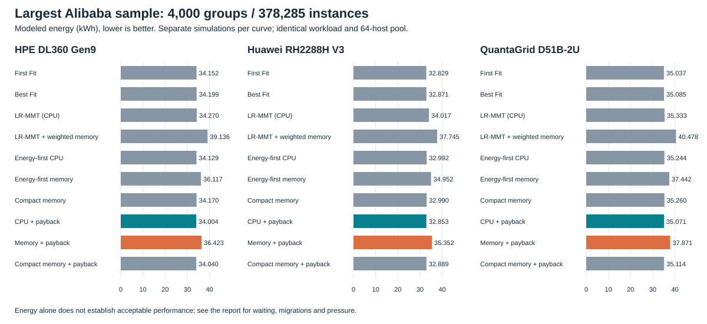

# Apples-to-apples baseline comparison

This analysis reuses existing validated Alibaba simulations; it does not generate new workloads or rerun the simulation. Both result sets were checked against current source hashes and the same input manifest. There are 90 unique runs: ten policies times three workload sizes times three separately simulated SPEC curves. The 18 overlapping CPU/memory energy-first baselines reproduce exactly and are counted once.

## What is held constant

Identical raw-derived Alibaba instances (16,534 / 68,457 / 378,285), original requests and multiplicity, task-create releases, individual observed runtimes, 64-host capacities, FIFO admission, migration model, 10-second wakeup, 60-second idle timeout, 5 W sleep and 300-second control interval. All cases fully drain without rejected/unfinished work or physical capacity violations. Energy covers the complete simulation, including any drain. Each server curve remains separate.

First Fit reuses powered hosts and picks the first feasible host; Best Fit favors the fullest CPU fit, with physical memory feasibility. These two do not migrate. LR-MMT is this repository's batch adaptation of local-regression detection and minimum-memory migration, not an exact reproduction of an external CloudSim implementation. All policies can sleep idle hosts. Full-policy comparisons measure the combined placement/controller behavior; only controlled CPU/memory ablations isolate memory awareness.

## Energy by curve and sample

Values are kWh; lower is better. All ten policies and adverse outcomes are retained.

### HPE DL360 Gen9

| Policy | 250 groups | 1,000 groups | 4,000 groups |
|---|---:|---:|---:|
| First Fit | 5.196158 | 8.975435 | 34.151822 |
| Best Fit | 5.202633 | 8.995054 | 34.198514 |
| LR-MMT (CPU) | 5.217227 | 9.032048 | 34.269962 |
| LR-MMT + weighted memory | 5.196949 | 9.152858 | 39.136094 |
| Energy-first CPU | 5.216789 | 9.018430 | 34.129353 |
| Energy-first memory | 5.192312 | 9.031747 | 36.117004 |
| Compact memory | 5.248831 | 9.053842 | 34.170486 |
| CPU + payback | 5.195320 | 8.978687 | 34.004057 |
| Memory + payback | 5.175196 | 9.011189 | 36.422752 |
| Compact memory + payback | 5.223565 | 9.029558 | 34.039997 |

### Huawei RH2288H V3

| Policy | 250 groups | 1,000 groups | 4,000 groups |
|---|---:|---:|---:|
| First Fit | 5.160144 | 8.797097 | 32.828993 |
| Best Fit | 5.166418 | 8.815802 | 32.870935 |
| LR-MMT (CPU) | 5.189138 | 8.969770 | 34.017004 |
| LR-MMT + weighted memory | 5.158752 | 8.964688 | 37.745319 |
| Energy-first CPU | 5.179556 | 8.847797 | 32.991997 |
| Energy-first memory | 5.154031 | 8.856492 | 34.951618 |
| Compact memory | 5.210460 | 8.889838 | 32.990434 |
| CPU + payback | 5.159203 | 8.801218 | 32.852545 |
| Memory + payback | 5.137984 | 8.830514 | 35.352446 |
| Compact memory + payback | 5.186569 | 8.855853 | 32.888862 |

### QuantaGrid D51B-2U

| Policy | 250 groups | 1,000 groups | 4,000 groups |
|---|---:|---:|---:|
| First Fit | 5.248996 | 9.158216 | 35.036588 |
| Best Fit | 5.255867 | 9.179279 | 35.085098 |
| LR-MMT (CPU) | 5.270602 | 9.230472 | 35.333163 |
| LR-MMT + weighted memory | 5.244489 | 9.356722 | 40.477587 |
| Energy-first CPU | 5.270635 | 9.215057 | 35.243717 |
| Energy-first memory | 5.245165 | 9.214876 | 37.441601 |
| Compact memory | 5.302762 | 9.259251 | 35.259904 |
| CPU + payback | 5.248064 | 9.165977 | 35.071337 |
| Memory + payback | 5.227720 | 9.181753 | 37.870680 |
| Compact memory + payback | 5.276485 | 9.222219 | 35.113760 |

## CPU + payback versus other baselines

Each percentage below compares sums over the same three sample sizes within one curve. Positive means CPU + payback saves energy. These sums describe this benchmark grid, not an estimate of a production mix.

| Curve | vs First Fit | vs Best Fit | vs LR-MMT CPU | vs original energy-first CPU |
|---|---:|---:|---:|---:|
| HPE DL360 Gen9 | +0.301% | +0.451% | +0.703% | +0.386% |
| Huawei RH2288H V3 | -0.057% | +0.086% | +2.829% | +0.439% |
| QuantaGrid D51B-2U | -0.084% | +0.070% | +0.700% | +0.491% |

## Per-case energy wins and performance checks

Each cell is **energy wins / wins also within performance limits**, out of nine cases. Limits reuse the prior development protocol: mean and p95 wait increase no more than max(1 second, 5% of the reference), and requested-resource pressure fraction increases no more than 0.01. These are heuristic tolerances, not a measured application SLA. Exact ties are not wins.

| Candidate | vs First Fit | vs Best Fit | vs LR-MMT CPU | vs energy-first CPU | vs CPU + payback |
|---|---:|---:|---:|---:|---:|
| First Fit | 0 / 0 | 9 / 9 | 9 / 6 | 8 / 6 | 5 / 5 |
| Best Fit | 0 / 0 | 0 / 0 | 9 / 6 | 8 / 6 | 0 / 0 |
| LR-MMT (CPU) | 0 / 0 | 0 / 0 | 0 / 0 | 1 / 1 | 0 / 0 |
| LR-MMT + weighted memory | 2 / 2 | 3 / 3 | 4 / 4 | 3 / 3 | 2 / 2 |
| Energy-first CPU | 1 / 1 | 1 / 1 | 8 / 8 | 0 / 0 | 0 / 0 |
| Energy-first memory | 3 / 3 | 3 / 3 | 6 / 6 | 4 / 4 | 3 / 3 |
| Compact memory | 0 / 0 | 1 / 1 | 4 / 4 | 1 / 1 | 0 / 0 |
| CPU + payback | 4 / 4 | 9 / 9 | 9 / 6 | 9 / 8 | 0 / 0 |
| Memory + payback | 3 / 3 | 3 / 3 | 6 / 6 | 6 / 6 | 3 / 3 |
| Compact memory + payback | 1 / 1 | 1 / 1 | 7 / 4 | 3 / 0 | 0 / 0 |

## Waiting, movement and pressure on the largest sample

All policies process the same 378,285 instances. Pressure is fraction of total simulated host time above the requested-resource threshold; it is not a measured service failure rate. Mean active hosts uses the engine's definition; see waking energy separately in summaries.json.

### HPE DL360 Gen9

| Policy | Mean wait (s) | P95 wait (s) | Migrations | Mean active hosts | Pressure (%) |
|---|---:|---:|---:|---:|---:|
| First Fit | 55.959 | 465.0 | 0 | 23.867 | 19.625 |
| Best Fit | 56.028 | 465.0 | 0 | 23.926 | 19.800 |
| LR-MMT (CPU) | 56.062 | 466.0 | 7,695 | 23.968 | 18.466 |
| LR-MMT + weighted memory | 54.470 | 465.0 | 7,222 | 32.606 | 14.069 |
| Energy-first CPU | 56.141 | 466.0 | 7,519 | 23.677 | 18.422 |
| Energy-first memory | 55.212 | 466.0 | 8,622 | 27.712 | 17.370 |
| Compact memory | 56.085 | 465.0 | 7,496 | 23.764 | 18.527 |
| CPU + payback | 56.160 | 465.0 | 2,466 | 23.543 | 19.546 |
| Memory + payback | 55.304 | 465.0 | 3,071 | 28.358 | 18.137 |
| Compact memory + payback | 56.139 | 465.0 | 2,504 | 23.618 | 19.622 |

### Huawei RH2288H V3

| Policy | Mean wait (s) | P95 wait (s) | Migrations | Mean active hosts | Pressure (%) |
|---|---:|---:|---:|---:|---:|
| First Fit | 55.959 | 465.0 | 0 | 23.867 | 19.625 |
| Best Fit | 56.028 | 465.0 | 0 | 23.926 | 19.800 |
| LR-MMT (CPU) | 55.588 | 466.0 | 9,103 | 25.859 | 17.256 |
| LR-MMT + weighted memory | 54.557 | 465.0 | 7,095 | 32.496 | 14.020 |
| Energy-first CPU | 56.086 | 466.0 | 6,913 | 23.987 | 17.889 |
| Energy-first memory | 55.292 | 465.0 | 8,026 | 27.804 | 16.769 |
| Compact memory | 56.107 | 466.0 | 6,956 | 23.978 | 17.918 |
| CPU + payback | 56.093 | 466.0 | 2,661 | 23.824 | 18.834 |
| Memory + payback | 55.092 | 466.0 | 2,947 | 28.699 | 17.430 |
| Compact memory + payback | 56.116 | 465.0 | 2,648 | 23.891 | 18.905 |

### QuantaGrid D51B-2U

| Policy | Mean wait (s) | P95 wait (s) | Migrations | Mean active hosts | Pressure (%) |
|---|---:|---:|---:|---:|---:|
| First Fit | 55.959 | 465.0 | 0 | 23.867 | 19.625 |
| Best Fit | 56.028 | 465.0 | 0 | 23.926 | 19.800 |
| LR-MMT (CPU) | 55.991 | 465.0 | 7,337 | 24.183 | 17.869 |
| LR-MMT + weighted memory | 54.479 | 465.0 | 7,138 | 32.572 | 14.121 |
| Energy-first CPU | 56.096 | 466.0 | 7,011 | 24.006 | 17.967 |
| Energy-first memory | 55.285 | 465.0 | 7,912 | 27.966 | 16.789 |
| Compact memory | 56.066 | 465.0 | 6,998 | 24.015 | 18.053 |
| CPU + payback | 56.144 | 466.0 | 2,542 | 23.819 | 18.942 |
| Memory + payback | 55.199 | 465.0 | 2,770 | 28.790 | 17.584 |
| Compact memory + payback | 56.148 | 466.0 | 2,495 | 23.871 | 19.097 |

## Interpretation and limits

CPU + payback is the strongest energy candidate among the new improvement variants, but it is not a consistent winner against First Fit: it saves energy in only 4/9 cases and its three-size total is slightly higher on Huawei and Quanta. First Fit also needs zero migrations. CPU + payback beats Best Fit in 9/9 cases within the performance tolerances, but beats LR-MMT in 9/9 on energy and only 6/9 within those tolerances, because pressure rises on the largest cases. Its gains must therefore be assessed against waiting and pressure, not energy alone. Memory + payback beats original energy-first CPU in 6/9 cases, but beats CPU + payback in only 3/9. Thus comparison against a weaker reference must not be used to attribute controller gains to memory awareness.

These are in-sample development results on three related samples, not nine independent replications. The three server curves are sensitivity cases, not additional independent workloads. No confidence interval or statistical significance claim is justified by this deterministic grid. Untouched Alibaba samples/time windows are still needed for generalization. Background online load and failures are not replayed; power is modeled from requested CPU, not measured on Alibaba hardware. No comparison to external published algorithm scores is made. The legacy compressed-archive checksum mismatch remains documented in RAW_Alibaba; member integrity/corroboration is not a publisher compressed-checksum match.

Rebuild with `python -m BASELINE_Comparison.build`. Full per-case energy/performance differences are in `all_pairwise_comparisons.csv`; raw metrics are in `summaries.json`. No historical synthetic ENERGY_Study outputs or Yaksh cleaned inputs are included.
