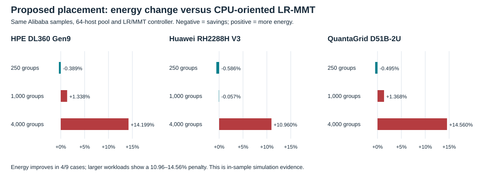

# Active proposal comparison

The active evaluation is **CPU-oriented LR-MMT versus LR-MMT + CPU/memory-aware placement**. First Fit and Best Fit are additional baselines. Later controller/placement extensions are excluded. Previous extension experiments are historical, outside this comparison.

## Same data and simulation

This reuses 36 validated raw-Alibaba outcomes with no new simulations or data changes. Each of three curves is evaluated separately for 250 / 1,000 / 4,000 groups (16,534 / 68,457 / 378,285 instances). All policies use the same raw-derived requests, task-create releases, original multiplicity, individual observed durations, 64-host pool, FIFO admission, power model and sleep assumptions. LR detection, MMT selection and controller parameters are identical in the primary pair; only placement scoring differs. The memory-aware implementation adds a weighted CPU/memory imbalance term to normalized incremental power. CPU-oriented placement still enforces memory capacity.

## Primary energy comparison

Positive change means the proposed memory-aware placement uses MORE energy; negative means savings.

| Curve | Groups | CPU LR-MMT kWh | Proposed kWh | Proposed energy change |
|---|---:|---:|---:|---:|
| HPE DL360 Gen9 | 250 | 5.217227 | 5.196949 | -0.3887% |
| HPE DL360 Gen9 | 1,000 | 9.032048 | 9.152858 | +1.3376% |
| HPE DL360 Gen9 | 4,000 | 34.269962 | 39.136094 | +14.1994% |
| Huawei RH2288H V3 | 250 | 5.189138 | 5.158752 | -0.5856% |
| Huawei RH2288H V3 | 1,000 | 8.969770 | 8.964688 | -0.0567% |
| Huawei RH2288H V3 | 4,000 | 34.017004 | 37.745319 | +10.9602% |
| QuantaGrid D51B-2U | 250 | 5.270602 | 5.244489 | -0.4955% |
| QuantaGrid D51B-2U | 1,000 | 9.230472 | 9.356722 | +1.3677% |
| QuantaGrid D51B-2U | 4,000 | 35.333163 | 40.477587 | +14.5598% |

The proposed variant saves energy in **4/9** cases; CPU-oriented LR-MMT saves energy in **5/9**. The proposed variant wins all three small cases and the medium Huawei case. It loses the other two medium cases and all three largest cases. On the largest workloads it uses **10.96–14.56% more energy**.

## Per-curve energy totals

These are sums over the same three sample sizes, not a production workload distribution.

| Curve | Proposed energy change vs CPU LR-MMT |
|---|---:|
| HPE DL360 Gen9 | +10.236% |
| Huawei RH2288H V3 | +7.665% |
| QuantaGrid D51B-2U | +10.524% |

## Performance on the largest workload

| Curve | Policy | Mean wait (s) | P95 wait (s) | Migrations | Mean active hosts | Pressure (%) |
|---|---|---:|---:|---:|---:|---:|
| HPE DL360 Gen9 | CPU-oriented LR-MMT | 56.062 | 466.0 | 7,695 | 23.968 | 18.466 |
| HPE DL360 Gen9 | LR-MMT + CPU/memory-aware placement (proposed) | 54.470 | 465.0 | 7,222 | 32.606 | 14.069 |
| Huawei RH2288H V3 | CPU-oriented LR-MMT | 55.588 | 466.0 | 9,103 | 25.859 | 17.256 |
| Huawei RH2288H V3 | LR-MMT + CPU/memory-aware placement (proposed) | 54.557 | 465.0 | 7,095 | 32.496 | 14.020 |
| QuantaGrid D51B-2U | CPU-oriented LR-MMT | 55.991 | 465.0 | 7,337 | 24.183 | 17.869 |
| QuantaGrid D51B-2U | LR-MMT + CPU/memory-aware placement (proposed) | 54.479 | 465.0 | 7,138 | 32.572 | 14.121 |

Memory-aware placement lowers modeled requested-resource pressure and mean waiting on the largest workload, but keeps more hosts powered. Thus CPU-oriented LR-MMT is better on energy overall in this grid, not better on every measured outcome. Pressure is a requested-resource proxy, not an observed application SLA.

## Additional baselines

### HPE DL360 Gen9

| Policy | 250 groups kWh | 1,000 groups kWh | 4,000 groups kWh |
|---|---:|---:|---:|
| First Fit | 5.196158 | 8.975435 | 34.151822 |
| Best Fit | 5.202633 | 8.995054 | 34.198514 |
| CPU-oriented LR-MMT | 5.217227 | 9.032048 | 34.269962 |
| LR-MMT + CPU/memory-aware placement (proposed) | 5.196949 | 9.152858 | 39.136094 |

### Huawei RH2288H V3

| Policy | 250 groups kWh | 1,000 groups kWh | 4,000 groups kWh |
|---|---:|---:|---:|
| First Fit | 5.160144 | 8.797097 | 32.828993 |
| Best Fit | 5.166418 | 8.815802 | 32.870935 |
| CPU-oriented LR-MMT | 5.189138 | 8.969770 | 34.017004 |
| LR-MMT + CPU/memory-aware placement (proposed) | 5.158752 | 8.964688 | 37.745319 |

### QuantaGrid D51B-2U

| Policy | 250 groups kWh | 1,000 groups kWh | 4,000 groups kWh |
|---|---:|---:|---:|
| First Fit | 5.248996 | 9.158216 | 35.036588 |
| Best Fit | 5.255867 | 9.179279 | 35.085098 |
| CPU-oriented LR-MMT | 5.270602 | 9.230472 | 35.333163 |
| LR-MMT + CPU/memory-aware placement (proposed) | 5.244489 | 9.356722 | 40.477587 |

## Verdict and limits

The current implementation does not support a claim of consistent energy reduction from adding memory-aware placement. The proposal asks when placement helps; the small-workload wins and energy/pressure tradeoff should be reported alongside losses. This is our batch adaptation of LR-MMT, not a bit-for-bit external CloudSim reproduction. The deterministic, overlapping samples and curve sensitivity cases are not independent replications. No generalization or significance claim follows.

Power is modeled using requested CPU and whole-server SPEC curves. Background online load, failures and DAG dependencies are not replayed. Task creation is the modeled release. The legacy archive checksum mismatch remains documented in RAW_Alibaba; raw member integrity/corroboration is not a publisher checksum match.

Rebuild: `python -m BASELINE_Comparison.build`. Source/input hashes and the original 54-run result grid are checked before selecting these 36 outcomes. All work completes without rejection, unfinished work or physical capacity violations. Full metrics: summaries.json; primary pairs: proposal_pairs.csv.
