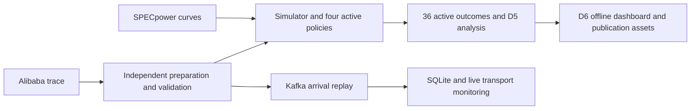

# EcoSched

EcoSched is an AMS 560 project studying whether CPU-and-memory-aware placement can reduce modeled data-center energy use without unacceptable overload or migration costs.

The completed active experiment compares **LR-MMT** with **LR-MMT + CPU/Memory-Aware Placement** using the same Alibaba workload, hosts, simulator, and SPECpower energy model. Results describe the simulation, not Alibaba's actual electricity consumption.

**Dataset rule:** all active experiments use verified Alibaba-derived trace inputs.
The active pipeline independently processes the user-downloaded raw archive;
see [RAW_Alibaba/README.md](RAW_Alibaba/README.md). The active proposal comparison is in
[BASELINE_Comparison/reports/REPORT.md](BASELINE_Comparison/reports/REPORT.md).
The full original six-policy raw-data results remain in [RAW_Alibaba/REPORT.md](RAW_Alibaba/REPORT.md).
Historical generated-workload diagnostics are excluded from project evidence.

The active comparison is **CPU-oriented LR-MMT versus LR-MMT + CPU/memory-aware
placement**, with First Fit and Best Fit as additional baselines. Rebuild it with
`python -m BASELINE_Comparison.build`. Later controller/placement extensions are
excluded from the project comparison; their code and results remain historical.

## Current status

**D1–D6 are implemented. The final package is ready for team/submission review; no course submission or release is implied.**

| Deliverable | Status |
|---|---|
| D1: Reproducible workload package | Complete — [active independent raw preparation](RAW_Alibaba/README.md); [original Yaksh handoff](YAKSH_Task/README.md) preserved |
| D2: Simulator and power model | Complete — [Brave's implementation and handoff](BRAVE_Task/README.md) |
| D3: Scheduling policies | Implemented — [Rohan's policies and integration](ROHAN_Task/README.md) |
| D4: Experiment matrix | Complete — [36 active outcomes](BASELINE_Comparison/reports/REPORT.md); the original [54-run raw collection](RAW_Alibaba/REPORT.md) is preserved and includes excluded policies |
| D5: Research analysis | Complete — [Rushi's energy-gap and placement analysis](RUSHI_Task/README.md) |
| D6: Final package | Complete for review — [Arnav’s dashboard, Kafka replay, report, slides and QA](ARNAV_Task/QUICKSTART.md) |

## Final package quick start

See the [fresh-clone guide](ARNAV_Task/QUICKSTART.md) and
[submission checklist](ARNAV_Task/final/SUBMISSION_CHECKLIST.md).

```bash
python3.12 -m venv ARNAV_Task/.runtime/venv
source ARNAV_Task/.runtime/venv/bin/activate
python -m pip install -r ARNAV_Task/requirements.txt
python -m streamlit run ARNAV_Task/dashboard/app.py
```

Open <http://localhost:8501>. Seven pages show offline simulation evidence; the
eighth monitors real Kafka arrival transport. It does not execute schedulers.
The primary variant saves modeled energy in **4/9** conditions and uses
**10.96–14.56% more energy** at 4,000 groups. Negative findings are preserved.



- [Final report PDF](ARNAV_Task/final/report/EcoSched_Final_Report.pdf),
  [editable DOCX](ARNAV_Task/final/report/EcoSched_Final_Report.docx).
- [Presentation PPTX](ARNAV_Task/final/presentation/EcoSched_Final_Presentation.pptx),
  [presentation PDF](ARNAV_Task/final/presentation/EcoSched_Final_Presentation.pdf),
  [demo runbook](ARNAV_Task/final/demo/demo_runbook.md).
- [Publication figures](ARNAV_Task/figures/), [academic tables](ARNAV_Task/reports/publication/tables/).

For replay, first follow [validated input restoration](ARNAV_Task/QUICKSTART.md#c-restore-authentic-active-study-inputs), then:

```bash
docker compose -f ARNAV_Task/docker-compose.yml up -d --wait
python -m ARNAV_Task.kafka.admin --ensure-topic
# In the dashboard: Live Workload Replay → 250 groups → 600× → Start.
python -m ARNAV_Task.scripts.verify_replay --replay-id latest
```

The original active archive and legacy release have different compressed hashes;
raw-member and prepared-file equivalence is checked separately. Seed 2026, a fixed
64-host pool and original instance multiplicity are preserved. Numerical validation
passes; three historical metadata links remain unresolved. No full scheduler
matrix was rerun in D6. See [provenance](ARNAV_Task/reports/provenance_reconciliation.md).

```bash
python -m pip install -r ARNAV_Task/requirements-dev.txt
python -m ARNAV_Task.scripts.final_qa
python -m ARNAV_Task.scripts.release_candidate --check-manifest
```

The dedicated D6 CI workflow performs offline validation without raw inputs,
Docker or Microsoft PowerPoint. Its GitHub-hosted run is pending review/push;
local checks are documented in [Phase 8 verification](ARNAV_Task/reports/phase8_verification.md).

Actual contributions: Yaksh Gandhi prepared the original historical workload
handoff; Brave Desai built the simulator/power model and active raw-study pipeline;
Rohan Rane implemented scheduler policies; Rushi Jhala supplied D5 analysis;
Arnav Desai integrated evidence, verified input recovery, built dashboard/Kafka
monitoring, publication exports and the final package. Git authorship and implementation
credit are distinguished in the final report and contribution table.

## Original handoffs and research entry points

For the active raw-data experiment, follow [RAW_Alibaba/README.md](RAW_Alibaba/README.md):

```sh
python -m RAW_Alibaba.extract
python -m RAW_Alibaba.prepare
python -m RAW_Alibaba.verify_data
python -m RAW_Alibaba.verify
```

The older commands below document the original prepared-data handoff. They load
the historical Yaksh package and are not the active fresh raw-archive pipeline.

1. Read [YAKSH_Task/README.md](YAKSH_Task/README.md) for what is ready and what the next teammate should do.
2. Run the data checks below. Python 3.10+ is sufficient; no packages need installing.
3. Use the [simulator handoff](YAKSH_Task/docs/SIMULATOR_HANDOFF.md) to integrate the prepared inputs.

Run Brave's simulator (Python 3.10+, standard library only):

```sh
python -m unittest discover -s tests -v
python -m ecosched --all-curves
```

The default first-fit integration baseline uses HPE ProLiant DL360 Gen9 power;
Huawei RH2288H V3 and QuantaGrid D51B-2U provide the two alternative curves.
See [Brave's handoff](BRAVE_Task/README.md) for assumptions, metrics, migration
support and the policy interface for Rohan/Rushi.

Run Rohan's policy comparison using the prepared inputs and shared simulator:

```sh
python -m unittest discover -s ROHAN_Task/tests -v
python -m ROHAN_Task.run --sizes 250 --curves hpe_dl360_gen9
```

The full `python -m ROHAN_Task.run` matrix covers all three workload sizes and
three power curves for first-fit, best-fit, LR-MMT and LR-MMT with memory-aware
placement. See [Rohan's handoff](ROHAN_Task/README.md) for the exact algorithm
adaptations and explicit migration assumptions.

```sh
python3 -m unittest discover -s YAKSH_Task/scripts -p 'test_*.py'
python3 YAKSH_Task/scripts/validate_data.py
```

Both commands are read-only and preserve the recorded full-source verification report.

Historical prepared files are already in the repository. **Offline D6 research pages require no raw data. Active replay inputs must be restored independently; do not substitute historical prepared samples.**

## Repository guide

| Location | Contents |
|---|---|
| [ARNAV_Task/](ARNAV_Task/) | Arnav’s integrated D6 package, eight-page dashboard, authentic Kafka replay, publication exports and final documents |
| [YAKSH_Task/](YAKSH_Task/) | Yaksh's completed data preparation, inputs, code, checks and handoff |
| [ecosched/](ecosched/) | Shared event simulator, power curves, baseline and command-line runner |
| [BRAVE_Task/](BRAVE_Task/) | Brave's simulator documentation and verified integration summaries |
| [ROHAN_Task/](ROHAN_Task/) | Scheduling policies, consolidation, tests, runner and comparison reports |
| [ENERGY_Study/](ENERGY_Study/) | Energy-first policies and fragmentation diagnostics evaluated on verified Alibaba-derived workloads; synthetic diagnostics retained only as history |
| [RAW_Alibaba/](RAW_Alibaba/) | Active independent raw-archive extraction, preparation, row-level verification and complete separate-curve replay |
| [RUSHI_Task/](RUSHI_Task/) | Rushi's D5 analysis: exact energy-gap breakdown, recorded placement decisions, results by task type, charts and handoff |
| [YAKSH_Task/REPORT.md](YAKSH_Task/REPORT.md) | Detailed data quality and sampling report |
| [docs/EcoSched_Proposal.pdf](docs/EcoSched_Proposal.pdf) | Original project proposal, preserved as submitted |
| [Latest handoff release](https://github.com/ai-calypse/Ecoshed/releases/tag/data-v1.1.0) | Updated portable handoff ZIP |
| [Original input downloads](https://github.com/ai-calypse/Ecoshed/releases/tag/data-v1.0.0) | Unmodified raw-data archive and proposal video |

Large original inputs are release assets to keep clones small. See [raw-data instructions](docs/RAW_DATA.md) only if you need to rebuild the inputs.

## Experiment inputs

Every policy must use the same fixed 64-host pool and the same workload files. Prepared workloads contain 250, 1,000 and 4,000 **task groups**. Each group represents its original `instance_num` independently schedulable instances.

Start with 250 groups for integration, then 1,000 for comparison. The 4,000-group input is a heavy burst stress case. Runtime estimates, missing measurements and resource units are documented with the data. Every sample now passes explicit instance/CPU/memory arrival-profile and resource-mix limits; see [sampling quality](YAKSH_Task/docs/SAMPLING_QUALITY.md).

## Sources

- [Alibaba Cluster Trace Program, v2017](https://github.com/alibaba/clusterdata/tree/master/cluster-trace-v2017)
- [SPECpower results](https://www.spec.org/power_ssj2008/results/) — measured source for the simulator's three power curves

The original proposal records the initial team allocation. The current handoff credits the completed data-preparation work to **Yaksh Gandhi**.
