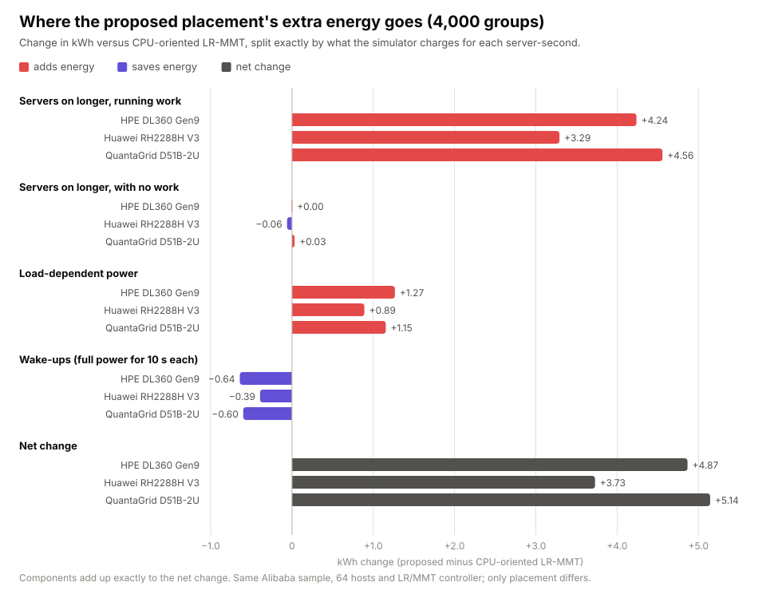
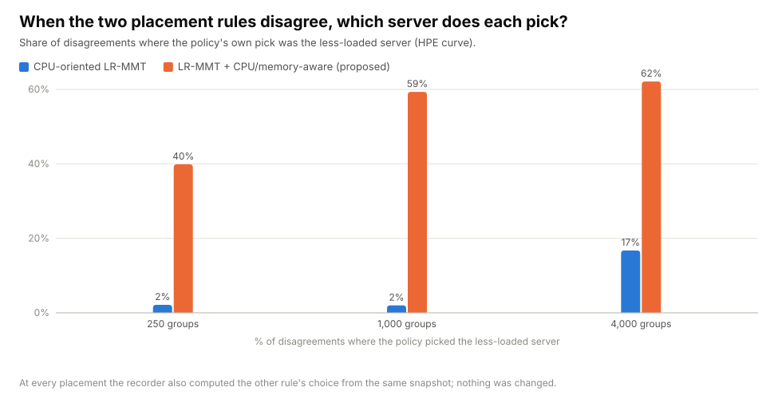
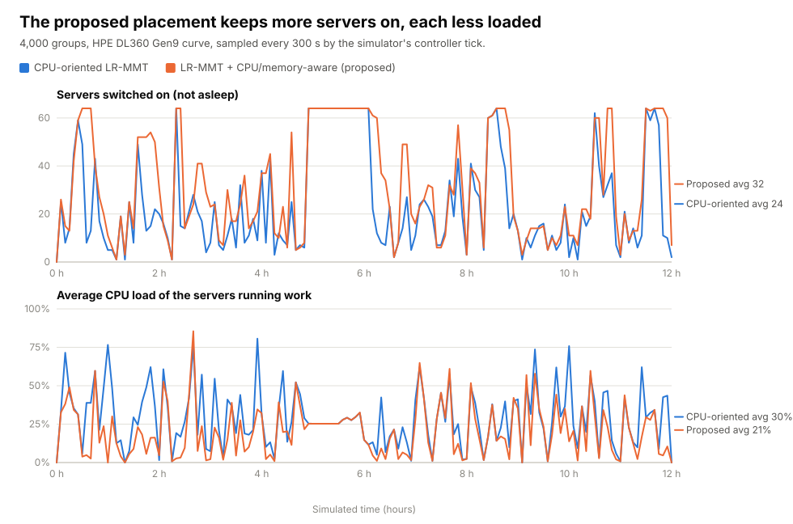
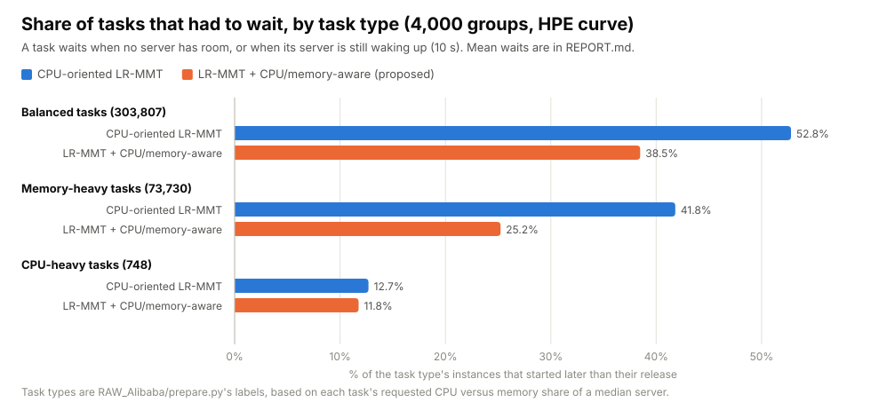

# Why CPU/memory-aware placement uses more energy at scale

**Owner:** Rushi Jhala. **Deliverable:** D5 (memory-aware extension and analysis) from the [proposal](../../docs/EcoSched_Proposal.pdf). Generated by `python -m RUSHI_Task.analyze`; every number below comes from committed simulator output. No workload, policy or simulator setting was changed.

## Short answer

- The proposed placement saves energy in **4/9** paired cases, all small or medium. On the largest workload it uses **10.96–14.56% more** energy.
- About **88%** of that extra energy is servers kept **switched on while running work** (roughly 106 more server-hours on the HPE curve). Servers sitting empty contribute essentially nothing (-0.2%). Load-dependent power adds 24%, and fewer wake-ups give back 12%.
- Cause: within powered-on servers, the balance term outweighs the power difference, so tasks are spread across more servers at lower load instead of being packed onto fewer servers. Waking a sleeping server is too expensive for the balance term to justify, so the proposed policy actually wakes servers **less** often.
- What it buys: lower overload pressure, less resource fragmentation and slightly shorter waits on the largest workload. This is an energy/performance trade-off, not a free improvement.
- By task type (the proposal's question): on the largest workload, memory-heavy tasks gain the most. The share that had to wait drops from 41.8% to 25.2% (balanced tasks: 52.8% to 38.5%, HPE curve), mainly because fewer tasks wait for a server to wake up. Mean waits change by at most 2 s.

## Inputs and checks

- 36 committed runs from `RAW_Alibaba/reports/summaries.json`. They are identical, row for row, to the 36 rows `BASELINE_Comparison` validated, and simulator source hashes still match every run. All runs complete every instance, with no rejections or capacity violations.
- `RAW_Alibaba/prepared/manifest.json` currently hashes to `91de65a667ac…`, but the runs and `RAW_Alibaba/data_validation.json` record `110e64972586…`. The prepared CSVs still match the committed manifest byte-for-byte, so this analysis checks everything except that one hash. See the README for the fix suggested to Brave.
- Energy accounting uses the simulator's own rule: every server-second is asleep (5 W), waking (full power for 10 s) or on (the SPECpower curve at its requested CPU load). The components below add up exactly to each run's total, and unit tests check that against the simulator.
- Decision recordings: 18 re-runs of the primary pair with a read-only recorder. Each re-run reproduced its committed summary field-for-field, which shows the recorder changed nothing. Inputs were rebuilt from the team's `data-v1.0.0` release archive; that archive matches Alibaba's published SHA-256, and all prepared CSVs match the committed manifest.

## 1. Where the extra energy goes

Positive kWh means the proposed placement used more energy than CPU-oriented LR-MMT.



| Curve | Groups | Net kWh | On longer, running work | On longer, no work | Load-dependent | Wake-ups | Wake-ups CPU → proposed | Powered servers CPU → proposed |
|---|---:|---:|---:|---:|---:|---:|---:|---:|
| HPE DL360 Gen9 | 250 | -0.020 | -0.009 | -0.008 | +0.012 | -0.016 | 295 → 274 | 1.2 → 1.2 |
| HPE DL360 Gen9 | 1,000 | +0.121 | +0.132 | +0.024 | +0.050 | -0.086 | 729 → 615 | 4.4 → 4.7 |
| HPE DL360 Gen9 | 4,000 | +4.866 | +4.238 | +0.003 | +1.267 | -0.641 | 1,974 → 1,122 | 24.0 → 32.6 |
| Huawei RH2288H V3 | 250 | -0.030 | -0.015 | -0.009 | +0.009 | -0.015 | 295 → 274 | 1.2 → 1.2 |
| Huawei RH2288H V3 | 1,000 | -0.005 | +0.032 | +0.007 | +0.017 | -0.061 | 694 → 610 | 4.7 → 4.7 |
| Huawei RH2288H V3 | 4,000 | +3.728 | +3.290 | -0.060 | +0.891 | -0.392 | 1,674 → 1,133 | 25.9 → 32.5 |
| QuantaGrid D51B-2U | 250 | -0.026 | -0.010 | -0.009 | +0.008 | -0.016 | 295 → 274 | 1.2 → 1.2 |
| QuantaGrid D51B-2U | 1,000 | +0.126 | +0.147 | +0.027 | +0.038 | -0.085 | 729 → 615 | 4.4 → 4.7 |
| QuantaGrid D51B-2U | 4,000 | +5.144 | +4.558 | +0.032 | +1.154 | -0.600 | 1,941 → 1,132 | 24.2 → 32.6 |

How the parts are defined (exact, from `RUSHI_Task/accounting.py`):

- **On longer**: each extra server-hour switched on instead of asleep costs (idle watts − 5 W), e.g. 40 W on the HPE curve, before it does any work. This is split into servers running at least one task and servers on with nothing to run.
- **Load-dependent**: power above idle. The same total work costs more when it is spread thinly, because the first 10% of CPU load is the steepest part of every SPECpower curve (table in section 2).
- **Wake-ups**: each wake-up runs a server at full power for 10 s instead of 5 W.

Reading: on the largest workload the proposed placement does not leave servers idling. It keeps more servers **busy at the same time**, so fewer of them empty out, fall asleep and save energy.

## 2. Why: the placement score arithmetic

Both policies score each candidate server and pick the lowest score (`ROHAN_Task/policies.py`, `LRMMT._score`):

```
power score   = (watts after placing − watts before) / (full watts − idle watts)
proposed adds = 0.25 × |CPU fraction − memory fraction|  (after placing)
```

| Curve | Watts added by the first 10% CPU | Cheapest 10% band | Score cost of waking a server | Balance gain needed to justify a wake-up |
|---|---:|---:|---:|---:|
| HPE DL360 Gen9 | 38.7 W | 12.0 W (40-50%) | 0.173 | 69 points |
| Huawei RH2288H V3 | 38.4 W | 13.4 W (10-20%) | 0.180 | 72 points |
| QuantaGrid D51B-2U | 38.4 W | 11.0 W (40-50%) | 0.201 | 80 points |

**Waking a sleeping server** costs 0.17–0.20 in score for any task size, while the balance term can add at most 0.25. The proposed rule would only wake a server for balance if that improved |CPU − memory| by 69–80 percentage points, which almost never happens. That is why it does **not** wake more servers (section 1 shows it wakes fewer).

**Choosing between servers that are already on** is different. Measured on the largest workload (CPU LR-MMT run, HPE curve): a typical task needs 0.78% of a server's CPU and 1.17% of its memory. On average, a server that is running work sits at 30% CPU but 57% memory, so it is memory-heavy. The table compares an empty powered-on server with a server at that average load (each curve uses its own CPU LR-MMT run).

| Curve | Power-score advantage of the busy server | Balance penalty on the busy server | Balance penalty on an empty server | Balance advantage ÷ power advantage |
|---|---:|---:|---:|---:|
| HPE DL360 Gen9 | 0.0078 | 0.0679 | 0.0010 | 8.6× |
| Huawei RH2288H V3 | 0.0088 | 0.0631 | 0.0010 | 7.0× |
| QuantaGrid D51B-2U | 0.0076 | 0.0677 | 0.0010 | 8.7× |

An empty server is perfectly balanced: 0% CPU and 0% memory, so a tiny task leaves it almost balanced. The busy server pays a balance penalty several times larger than its power advantage. Among powered-on servers, the proposed rule therefore decides mainly by balance: it moves tasks away from busy, memory-heavy servers towards emptier ones, which keeps more servers running work. CPU-only scoring does the opposite. The cheapest place for a small task is a server already in the middle of the curve, so it packs work together.

## 3. What the policies actually did

The recorder saw every placement decision. It also computed the other rule's pick from the same snapshot, so the two rules can be compared decision by decision without changing the run.



On the largest workload, when the two rules disagree, the proposed policy's own pick is the less-loaded server in **35–62%** of cases, against **17–24%** for CPU-oriented LR-MMT. Replaying CPU LR-MMT's own decisions, the proposed rule would have sent **13.6–21.6%** of all tasks to a powered-on server with no work, where CPU-only scoring added them to a server that already had work.

The consolidation controller then pushes back. On the HPE curve it planned to empty 931 under-used hosts (moving all their tasks elsewhere) for the proposed policy, against 464 for CPU LR-MMT, using 4,871 against 2,524 consolidation migrations. Even so, about eight more servers stay on: placement spreads tasks faster than consolidation packs them back.

| Curve | Groups | Policy | Rules disagree | Own pick less loaded (of disagreements) | Other rule would use an empty server | Mean CPU of chosen server after placing |
|---|---:|---:|---:|---:|---:|---:|
| HPE DL360 Gen9 | 250 | CPU-oriented LR-MMT | 5.9% | 2.1% | 2.7% | 33.6% |
| HPE DL360 Gen9 | 250 | LR-MMT + CPU/memory-aware (proposed) | 4.2% | 39.9% | 0.0% | 37.6% |
| HPE DL360 Gen9 | 1,000 | CPU-oriented LR-MMT | 26.4% | 2.0% | 13.5% | 33.5% |
| HPE DL360 Gen9 | 1,000 | LR-MMT + CPU/memory-aware (proposed) | 28.3% | 59.3% | 0.4% | 34.7% |
| HPE DL360 Gen9 | 4,000 | CPU-oriented LR-MMT | 55.0% | 16.7% | 21.6% | 42.0% |
| HPE DL360 Gen9 | 4,000 | LR-MMT + CPU/memory-aware (proposed) | 68.0% | 62.1% | 0.1% | 38.2% |
| Huawei RH2288H V3 | 250 | CPU-oriented LR-MMT | 5.6% | 2.9% | 0.9% | 33.5% |
| Huawei RH2288H V3 | 250 | LR-MMT + CPU/memory-aware (proposed) | 4.5% | 30.7% | 0.0% | 37.6% |
| Huawei RH2288H V3 | 1,000 | CPU-oriented LR-MMT | 28.8% | 5.3% | 5.9% | 33.0% |
| Huawei RH2288H V3 | 1,000 | LR-MMT + CPU/memory-aware (proposed) | 28.8% | 33.9% | 0.4% | 34.7% |
| Huawei RH2288H V3 | 4,000 | CPU-oriented LR-MMT | 60.7% | 23.6% | 13.6% | 40.6% |
| Huawei RH2288H V3 | 4,000 | LR-MMT + CPU/memory-aware (proposed) | 69.9% | 34.7% | 0.1% | 38.1% |
| QuantaGrid D51B-2U | 250 | CPU-oriented LR-MMT | 5.9% | 0.6% | 2.7% | 33.6% |
| QuantaGrid D51B-2U | 250 | LR-MMT + CPU/memory-aware (proposed) | 4.3% | 34.7% | 0.0% | 37.6% |
| QuantaGrid D51B-2U | 1,000 | CPU-oriented LR-MMT | 26.4% | 3.9% | 13.2% | 33.4% |
| QuantaGrid D51B-2U | 1,000 | LR-MMT + CPU/memory-aware (proposed) | 27.7% | 44.3% | 0.3% | 34.6% |
| QuantaGrid D51B-2U | 4,000 | CPU-oriented LR-MMT | 56.6% | 22.8% | 21.6% | 41.4% |
| QuantaGrid D51B-2U | 4,000 | LR-MMT + CPU/memory-aware (proposed) | 68.6% | 51.6% | 0.0% | 38.1% |

Where tasks were placed (share of all placements, by the chosen server's state just before):

| Curve | Groups | Policy | asleep (woken for it) | still waking up | on, with no work | on, already running work |
|---|---:|---:|---:|---:|---:|---:|
| HPE DL360 Gen9 | 250 | CPU-oriented LR-MMT | 1.7% | 82.5% | 0.4% | 15.3% |
| HPE DL360 Gen9 | 250 | LR-MMT + CPU/memory-aware (proposed) | 1.6% | 82.5% | 0.5% | 15.4% |
| HPE DL360 Gen9 | 1,000 | CPU-oriented LR-MMT | 1.0% | 56.1% | 0.4% | 42.4% |
| HPE DL360 Gen9 | 1,000 | LR-MMT + CPU/memory-aware (proposed) | 0.9% | 50.6% | 0.9% | 47.6% |
| HPE DL360 Gen9 | 4,000 | CPU-oriented LR-MMT | 0.5% | 34.7% | 0.2% | 64.6% |
| HPE DL360 Gen9 | 4,000 | LR-MMT + CPU/memory-aware (proposed) | 0.3% | 20.4% | 1.0% | 78.3% |
| Huawei RH2288H V3 | 250 | CPU-oriented LR-MMT | 1.7% | 82.5% | 0.4% | 15.3% |
| Huawei RH2288H V3 | 250 | LR-MMT + CPU/memory-aware (proposed) | 1.6% | 82.5% | 0.5% | 15.4% |
| Huawei RH2288H V3 | 1,000 | CPU-oriented LR-MMT | 1.0% | 52.8% | 0.6% | 45.6% |
| Huawei RH2288H V3 | 1,000 | LR-MMT + CPU/memory-aware (proposed) | 0.9% | 50.2% | 0.9% | 48.0% |
| Huawei RH2288H V3 | 4,000 | CPU-oriented LR-MMT | 0.4% | 29.8% | 0.5% | 69.3% |
| Huawei RH2288H V3 | 4,000 | LR-MMT + CPU/memory-aware (proposed) | 0.3% | 20.9% | 1.0% | 77.8% |
| QuantaGrid D51B-2U | 250 | CPU-oriented LR-MMT | 1.7% | 82.5% | 0.4% | 15.3% |
| QuantaGrid D51B-2U | 250 | LR-MMT + CPU/memory-aware (proposed) | 1.6% | 82.5% | 0.5% | 15.4% |
| QuantaGrid D51B-2U | 1,000 | CPU-oriented LR-MMT | 1.0% | 56.1% | 0.4% | 42.4% |
| QuantaGrid D51B-2U | 1,000 | LR-MMT + CPU/memory-aware (proposed) | 0.9% | 50.6% | 0.9% | 47.5% |
| QuantaGrid D51B-2U | 4,000 | CPU-oriented LR-MMT | 0.5% | 34.2% | 0.2% | 65.1% |
| QuantaGrid D51B-2U | 4,000 | LR-MMT + CPU/memory-aware (proposed) | 0.3% | 20.6% | 1.0% | 78.2% |

Most tasks land on a server that is still waking up: tasks arrive in bursts (a task group releases all its instances at once), so the first task wakes a server and the next ones follow it there.



| Curve | Groups | Policy | Powered servers (tick mean) | Servers running work | CPU load of servers running work | Memory load of servers running work |
|---|---:|---:|---:|---:|---:|---:|
| HPE DL360 Gen9 | 250 | CPU-oriented LR-MMT | 1.26 | 0.74 | 27.1% | 33.1% |
| HPE DL360 Gen9 | 250 | LR-MMT + CPU/memory-aware (proposed) | 1.23 | 0.74 | 28.5% | 30.7% |
| HPE DL360 Gen9 | 1,000 | CPU-oriented LR-MMT | 4.46 | 3.37 | 28.7% | 42.4% |
| HPE DL360 Gen9 | 1,000 | LR-MMT + CPU/memory-aware (proposed) | 4.54 | 3.53 | 28.0% | 38.3% |
| HPE DL360 Gen9 | 4,000 | CPU-oriented LR-MMT | 24.17 | 20.99 | 29.7% | 56.9% |
| HPE DL360 Gen9 | 4,000 | LR-MMT + CPU/memory-aware (proposed) | 32.46 | 29.82 | 21.1% | 42.0% |
| Huawei RH2288H V3 | 250 | CPU-oriented LR-MMT | 1.28 | 0.78 | 26.6% | 32.3% |
| Huawei RH2288H V3 | 250 | LR-MMT + CPU/memory-aware (proposed) | 1.23 | 0.74 | 28.5% | 30.7% |
| Huawei RH2288H V3 | 1,000 | CPU-oriented LR-MMT | 4.70 | 3.56 | 26.8% | 40.0% |
| Huawei RH2288H V3 | 1,000 | LR-MMT + CPU/memory-aware (proposed) | 4.54 | 3.54 | 28.2% | 38.3% |
| Huawei RH2288H V3 | 4,000 | CPU-oriented LR-MMT | 26.03 | 23.44 | 24.9% | 50.1% |
| Huawei RH2288H V3 | 4,000 | LR-MMT + CPU/memory-aware (proposed) | 32.28 | 29.75 | 21.1% | 41.8% |
| QuantaGrid D51B-2U | 250 | CPU-oriented LR-MMT | 1.26 | 0.74 | 27.1% | 33.1% |
| QuantaGrid D51B-2U | 250 | LR-MMT + CPU/memory-aware (proposed) | 1.23 | 0.74 | 28.5% | 30.7% |
| QuantaGrid D51B-2U | 1,000 | CPU-oriented LR-MMT | 4.47 | 3.39 | 28.6% | 42.3% |
| QuantaGrid D51B-2U | 1,000 | LR-MMT + CPU/memory-aware (proposed) | 4.54 | 3.57 | 27.9% | 38.2% |
| QuantaGrid D51B-2U | 4,000 | CPU-oriented LR-MMT | 24.32 | 21.29 | 29.7% | 56.8% |
| QuantaGrid D51B-2U | 4,000 | LR-MMT + CPU/memory-aware (proposed) | 32.45 | 29.77 | 21.1% | 41.7% |

Controller activity (same LR detector and MMT selector in both; counts from the policy's diagnostics):

| Curve | Groups | Policy | Overloaded host-ticks | Overload migrations | Consolidation migrations | Hosts evacuated | Evacuations rolled back |
|---|---:|---:|---:|---:|---:|---:|---:|
| HPE DL360 Gen9 | 250 | CPU-oriented LR-MMT | 39 | 195 | 80 | 22 | 13 |
| HPE DL360 Gen9 | 250 | LR-MMT + CPU/memory-aware (proposed) | 35 | 200 | 76 | 23 | 13 |
| HPE DL360 Gen9 | 1,000 | CPU-oriented LR-MMT | 176 | 1,051 | 583 | 87 | 15 |
| HPE DL360 Gen9 | 1,000 | LR-MMT + CPU/memory-aware (proposed) | 141 | 951 | 531 | 107 | 12 |
| HPE DL360 Gen9 | 4,000 | CPU-oriented LR-MMT | 1,827 | 5,171 | 2,524 | 464 | 2 |
| HPE DL360 Gen9 | 4,000 | LR-MMT + CPU/memory-aware (proposed) | 1,377 | 2,351 | 4,871 | 931 | 2 |
| Huawei RH2288H V3 | 250 | CPU-oriented LR-MMT | 39 | 195 | 112 | 26 | 13 |
| Huawei RH2288H V3 | 250 | LR-MMT + CPU/memory-aware (proposed) | 35 | 200 | 76 | 23 | 13 |
| Huawei RH2288H V3 | 1,000 | CPU-oriented LR-MMT | 174 | 1,035 | 711 | 103 | 12 |
| Huawei RH2288H V3 | 1,000 | LR-MMT + CPU/memory-aware (proposed) | 140 | 940 | 503 | 105 | 12 |
| Huawei RH2288H V3 | 4,000 | CPU-oriented LR-MMT | 1,707 | 4,515 | 4,588 | 725 | 3 |
| Huawei RH2288H V3 | 4,000 | LR-MMT + CPU/memory-aware (proposed) | 1,352 | 2,288 | 4,807 | 915 | 2 |
| QuantaGrid D51B-2U | 250 | CPU-oriented LR-MMT | 39 | 195 | 80 | 22 | 13 |
| QuantaGrid D51B-2U | 250 | LR-MMT + CPU/memory-aware (proposed) | 35 | 200 | 76 | 23 | 13 |
| QuantaGrid D51B-2U | 1,000 | CPU-oriented LR-MMT | 176 | 1,050 | 490 | 80 | 15 |
| QuantaGrid D51B-2U | 1,000 | LR-MMT + CPU/memory-aware (proposed) | 139 | 924 | 545 | 106 | 13 |
| QuantaGrid D51B-2U | 4,000 | CPU-oriented LR-MMT | 1,785 | 4,917 | 2,420 | 460 | 1 |
| QuantaGrid D51B-2U | 4,000 | LR-MMT + CPU/memory-aware (proposed) | 1,376 | 2,348 | 4,790 | 930 | 2 |

## 4. Results by task type

Task types come from `RAW_Alibaba/prepare.py`: a task is CPU-heavy if its CPU share of a median server is more than twice its memory share, memory-heavy if less than half, otherwise balanced.

| Groups | Instances | Balanced | Memory-heavy | CPU-heavy |
|---|---:|---:|---:|---:|
| 250 | 16,534 | 92.0% | 8.0% | 0.00% |
| 1,000 | 68,457 | 76.1% | 23.8% | 0.14% |
| 4,000 | 378,285 | 80.3% | 19.5% | 0.20% |



On the largest workload, the proposed placement mostly changes **how many tasks wait at all**, not how long the long waits are. The share of memory-heavy tasks that waited falls by 10–17 percentage points, and for balanced tasks by 9–14 points. Mean waits move by at most 1.8 s, and P95 waits barely change. The 'placed on an asleep or waking server' column shows why. Fewer tasks have to wait the 10 s wake-up, because more servers are already on. That is the same extra powered-on time that costs energy in section 1. Memory-heavy tasks, the type this policy targets, gain the most on every curve.

At 250 and 1,000 groups every wait is a wake-up wait. The two percentage columns are identical and P95 is exactly the 10 s wake latency, because no task queues for capacity at those sizes. On the smallest workload the effect reverses for memory-heavy tasks: slightly more of them wait under the proposed placement.

| Curve | Groups | Task type | Instances | Waited at all CPU → proposed | Placed on an asleep or waking server | Mean wait CPU → proposed (s) | P95 wait CPU → proposed (s) | Migrated CPU → proposed |
|---|---:|---:|---:|---:|---:|---:|---:|---:|
| HPE DL360 Gen9 | 250 | Balanced | 15,217 | 85.3% → 84.8% | 85.3% → 84.8% | 8.5 → 8.5 | 10 → 10 | 1.8% → 1.7% |
| HPE DL360 Gen9 | 250 | Memory-heavy | 1,317 | 72.5% → 76.0% | 72.5% → 76.0% | 7.3 → 7.6 | 10 → 10 | 0.3% → 0.9% |
| HPE DL360 Gen9 | 1,000 | Balanced | 52,062 | 54.9% → 49.7% | 54.9% → 49.7% | 5.4 → 4.9 | 10 → 10 | 2.0% → 1.9% |
| HPE DL360 Gen9 | 1,000 | Memory-heavy | 16,297 | 64.7% → 57.2% | 64.7% → 57.2% | 6.5 → 5.7 | 10 → 10 | 3.4% → 3.1% |
| HPE DL360 Gen9 | 1,000 | CPU-heavy | 98 | 10.2% → 10.2% | 10.2% → 10.2% | 1.0 → 1.0 | 10 → 10 | 15.3% → 12.2% |
| HPE DL360 Gen9 | 4,000 | Balanced | 303,807 | 52.8% → 38.5% | 36.2% → 22.2% | 53.3 → 51.8 | 112 → 110 | 1.4% → 1.4% |
| HPE DL360 Gen9 | 4,000 | Memory-heavy | 73,730 | 41.8% → 25.2% | 31.3% → 14.8% | 67.3 → 65.6 | 523 → 521 | 4.4% → 3.9% |
| HPE DL360 Gen9 | 4,000 | CPU-heavy | 748 | 12.7% → 11.8% | 7.9% → 7.0% | 53.7 → 53.5 | 8 → 7 | 13.6% → 11.5% |
| Huawei RH2288H V3 | 250 | Balanced | 15,217 | 85.3% → 84.8% | 85.3% → 84.8% | 8.5 → 8.5 | 10 → 10 | 2.0% → 1.7% |
| Huawei RH2288H V3 | 250 | Memory-heavy | 1,317 | 72.5% → 76.0% | 72.5% → 76.0% | 7.3 → 7.6 | 10 → 10 | 0.8% → 0.9% |
| Huawei RH2288H V3 | 1,000 | Balanced | 52,062 | 51.1% → 49.4% | 51.1% → 49.4% | 5.1 → 4.9 | 10 → 10 | 2.2% → 1.8% |
| Huawei RH2288H V3 | 1,000 | Memory-heavy | 16,297 | 62.8% → 56.6% | 62.8% → 56.6% | 6.3 → 5.7 | 10 → 10 | 3.6% → 3.0% |
| Huawei RH2288H V3 | 1,000 | CPU-heavy | 98 | 10.2% → 10.2% | 10.2% → 10.2% | 1.0 → 1.0 | 10 → 10 | 18.4% → 12.2% |
| Huawei RH2288H V3 | 4,000 | Balanced | 303,807 | 48.1% → 39.1% | 31.6% → 22.7% | 52.9 → 51.9 | 110 → 110 | 1.7% → 1.4% |
| Huawei RH2288H V3 | 4,000 | Memory-heavy | 73,730 | 35.4% → 25.4% | 24.9% → 15.0% | 66.7 → 65.6 | 523 → 523 | 5.1% → 3.8% |
| Huawei RH2288H V3 | 4,000 | CPU-heavy | 748 | 12.2% → 11.4% | 7.4% → 6.6% | 53.7 → 53.5 | 8 → 7 | 11.9% → 12.7% |
| QuantaGrid D51B-2U | 250 | Balanced | 15,217 | 85.3% → 84.8% | 85.3% → 84.8% | 8.5 → 8.5 | 10 → 10 | 1.8% → 1.7% |
| QuantaGrid D51B-2U | 250 | Memory-heavy | 1,317 | 72.5% → 76.0% | 72.5% → 76.0% | 7.3 → 7.6 | 10 → 10 | 0.3% → 0.9% |
| QuantaGrid D51B-2U | 1,000 | Balanced | 52,062 | 54.9% → 49.8% | 54.9% → 49.8% | 5.4 → 4.9 | 10 → 10 | 1.9% → 1.8% |
| QuantaGrid D51B-2U | 1,000 | Memory-heavy | 16,297 | 64.6% → 57.1% | 64.6% → 57.1% | 6.5 → 5.7 | 10 → 10 | 3.4% → 3.1% |
| QuantaGrid D51B-2U | 1,000 | CPU-heavy | 98 | 10.2% → 10.2% | 10.2% → 10.2% | 1.0 → 1.0 | 10 → 10 | 15.3% → 12.2% |
| QuantaGrid D51B-2U | 4,000 | Balanced | 303,807 | 52.3% → 38.5% | 35.8% → 22.2% | 53.3 → 51.8 | 112 → 110 | 1.3% → 1.4% |
| QuantaGrid D51B-2U | 4,000 | Memory-heavy | 73,730 | 40.7% → 26.1% | 30.3% → 15.7% | 67.2 → 65.6 | 523 → 522 | 4.4% → 3.7% |
| QuantaGrid D51B-2U | 4,000 | CPU-heavy | 748 | 12.3% → 9.4% | 7.5% → 4.5% | 53.7 → 53.3 | 8 → 3 | 13.8% → 9.8% |

Energy is charged per server, not per task, so energy cannot be split by task type without an extra allocation assumption. Waiting and migration outcomes can be split exactly, so those are reported instead.

## 5. The trade-off

Negative wait/pressure changes favour the proposed placement; positive energy changes favour CPU-oriented LR-MMT.

| Curve | Groups | Energy | Mean wait | P95 wait | Pressure | Migrations CPU → proposed | Fragmentation index CPU → proposed |
|---|---:|---:|---:|---:|---:|---:|---:|
| HPE DL360 Gen9 | 250 | -0.39% | -0.02 s | +0 s | -0.06 pts | 275 → 276 | 0.0002 → 0.0002 |
| HPE DL360 Gen9 | 1,000 | +1.34% | -0.58 s | +0 s | -0.38 pts | 1,634 → 1,482 | 0.0032 → 0.0030 |
| HPE DL360 Gen9 | 4,000 | +14.20% | -1.59 s | -1 s | -4.40 pts | 7,695 → 7,222 | 0.0198 → 0.0086 |
| Huawei RH2288H V3 | 250 | -0.59% | -0.02 s | +0 s | -0.05 pts | 307 → 276 | 0.0002 → 0.0002 |
| Huawei RH2288H V3 | 1,000 | -0.06% | -0.29 s | +0 s | -0.33 pts | 1,746 → 1,443 | 0.0025 → 0.0044 |
| Huawei RH2288H V3 | 4,000 | +10.96% | -1.03 s | -1 s | -3.24 pts | 9,103 → 7,095 | 0.0159 → 0.0112 |
| QuantaGrid D51B-2U | 250 | -0.50% | -0.02 s | +0 s | -0.06 pts | 275 → 276 | 0.0002 → 0.0002 |
| QuantaGrid D51B-2U | 1,000 | +1.37% | -0.58 s | +0 s | -0.36 pts | 1,540 → 1,469 | 0.0031 → 0.0029 |
| QuantaGrid D51B-2U | 4,000 | +14.56% | -1.51 s | +0 s | -3.75 pts | 7,337 → 7,138 | 0.0193 → 0.0100 |

On the largest workload the proposed placement does what it was designed to do: on all three curves it lowers fragmentation, pressure and mean wait. In this simulator, though, energy depends mostly on how many servers are switched on. Balancing spreads work across more servers, so it costs energy whenever the load is large enough to keep those extra servers busy. At smaller sizes the differences are small and mixed; fragmentation even rises in the 1,000-group Huawei RH2288H V3 case.

## Limits

- Simulation estimates from requested resources and whole-server SPECpower curves, not measured Alibaba electricity. Background online load, failures and DAG dependencies are not replayed.
- Nine overlapping, deterministic cases (three sizes × three curves) are not independent replications, so no significance or generalisation claim follows.
- The balance weight is fixed at the implemented 0.25. No weight was tuned: AGENTS.md excludes new placement variants and the core freeze applies. A weight sensitivity study is listed as optional follow-up in the README.
- Task types are based on requested resources, not observed usage.

## Rebuild

```
python -m unittest discover -s RUSHI_Task/tests -v
python -m RUSHI_Task.analyze        # tables, charts and this report from committed files
python -m RUSHI_Task.rerun          # optional: re-record decisions (needs prepared inputs, ~20 min)
```
