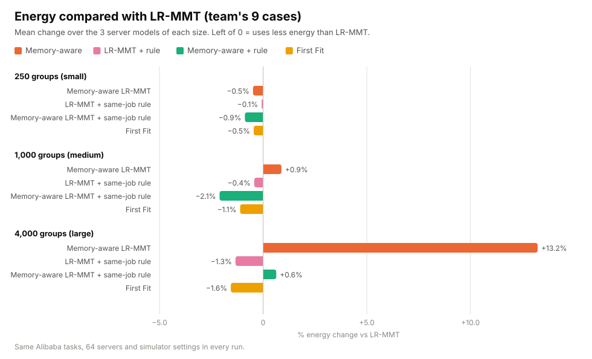
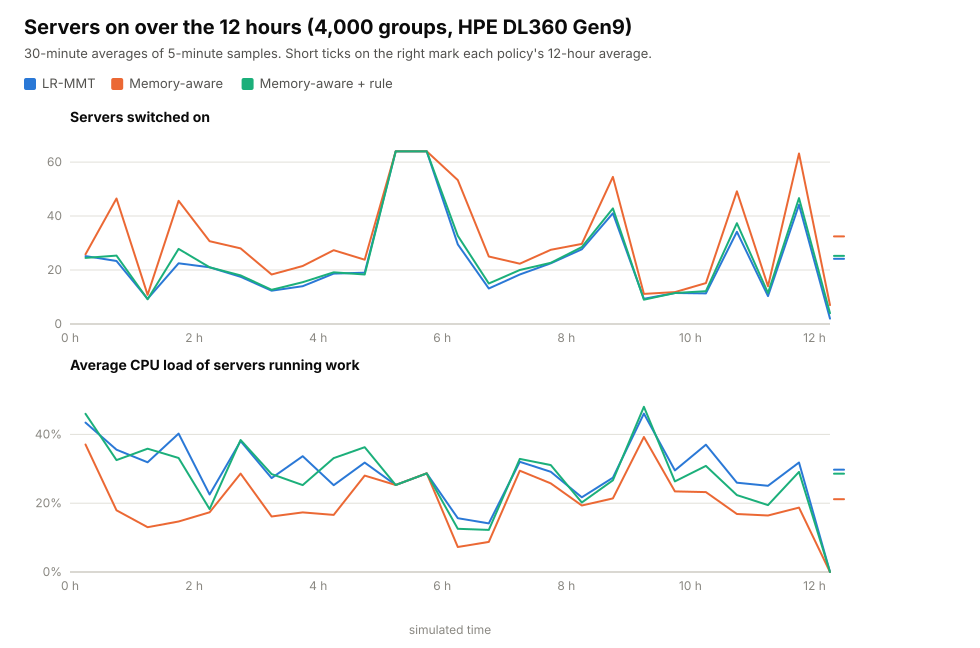
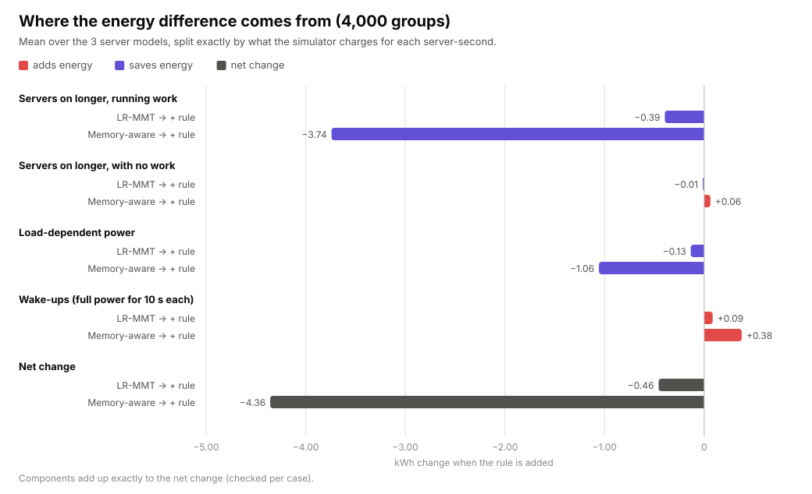
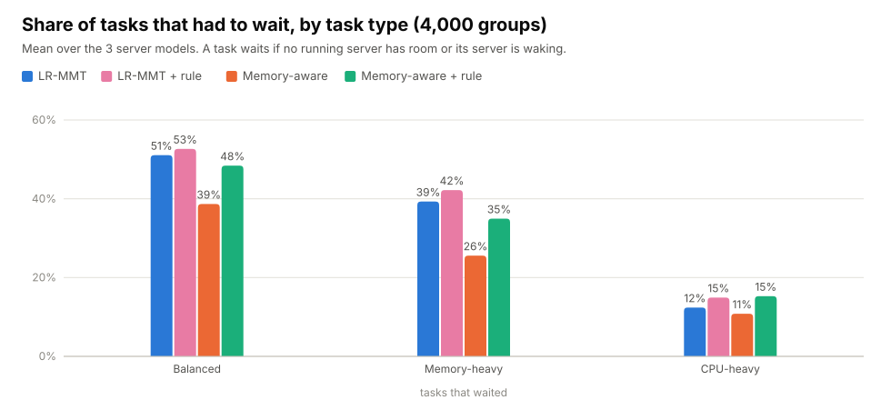

# The same-job rule on the team's 9 cases

**Owner:** Rushi Jhala (D5 extension). Design, rule, comparisons and success criteria: [DESIGN.md](../DESIGN.md), fixed before any run. Generated by `python -m RUSHI_Task.same_job.analyze`. A from-scratch explanation is in [the guide](../../guide/EcoSched_Same_Job_Rule_Guide.pdf). Negative = less energy.

**Data: only the team's.** The same 9 cases as `BASELINE_Comparison` (250 / 1,000 / 4,000 groups × 3 SPECpower curves), the same tasks, 64 hosts and simulator settings. First Fit and Best Fit use the team's committed results. This is an extension next to the frozen active comparison (AGENTS.md): it adds two policies and changes no workload, setting or existing result.

## Verdicts

| ID | Comparison | Energy wins | Total energy | 250 | 1,000 | 4,000 | Outside limits | Works better? |
|---|---|---:|---:|---:|---:|---:|---:|---|
| S1 | LR-MMT + same-job rule vs LR-MMT | 9/9 | −1.02% | −0.07% | −0.43% | −1.33% | 0 | **yes** |
| S2 | Memory-aware LR-MMT + same-job rule vs Memory-aware LR-MMT | 9/9 | −8.69% | −0.39% | −2.96% | −11.13% | 1 | no |
| S3 | LR-MMT + same-job rule vs First Fit | 0/9 | +0.33% | +0.39% | +0.69% | +0.23% | 0 | no |
| S4 | Memory-aware LR-MMT + same-job rule vs First Fit | 6/9 | +1.34% | −0.42% | −1.00% | +2.22% | 0 | no |
| S5 | Memory-aware LR-MMT + same-job rule vs LR-MMT | 7/9 | −0.03% | −0.88% | −2.10% | +0.63% | 0 | **yes** |
| S6 | Memory-aware LR-MMT + same-job rule vs LR-MMT + same-job rule | 6/9 | +1.00% | −0.81% | −1.68% | +1.99% | 0 | no |

Size columns are the mean change over the 3 server models. *Works better* = less energy in more than half of the 9 cases, lower total energy, and every win within the team's limits (mean and P95 wait +max(1 s, 5%), pressure +0.01, from `POLICY_Improvement/config.json`).

- Outside the limits: S2, 4,000 groups, Huawei RH2288H V3: energy −11.17%, but pressure +1.11 points (limit +1.00).

## Least energy in each case

| Algorithm | Lowest energy (of 6) | Lowest energy (original 4 only) |
|---|---:|---:|
| First Fit | 3 of 9 | 7 of 9 |
| Best Fit | 0 of 9 | 0 of 9 |
| LR-MMT | 0 of 9 | 0 of 9 |
| Memory-aware LR-MMT | 0 of 9 | 2 of 9 |
| LR-MMT + same-job rule | 0 of 9 | – |
| Memory-aware LR-MMT + same-job rule | 6 of 9 | – |

| Groups | Server model | First Fit | Best Fit | LR-MMT | Memory-aware LR-MMT | LR-MMT + same-job rule | Memory-aware LR-MMT + same-job rule |
|---:|---|---:|---:|---:|---:|---:|---:|
| 250 | HPE DL360 Gen9 | 5.196 | 5.203 | 5.217 | 5.197 | 5.216 | **5.177** |
| 250 | Huawei RH2288H V3 | 5.160 | 5.166 | 5.189 | 5.159 | 5.179 | **5.139** |
| 250 | QuantaGrid D51B-2U | 5.249 | 5.256 | 5.271 | 5.244 | 5.270 | **5.223** |
| 1,000 | HPE DL360 Gen9 | 8.975 | 8.995 | 9.032 | 9.153 | 9.031 | **8.890** |
| 1,000 | Huawei RH2288H V3 | 8.797 | 8.816 | 8.970 | 8.965 | 8.861 | **8.713** |
| 1,000 | QuantaGrid D51B-2U | 9.158 | 9.179 | 9.230 | 9.357 | 9.225 | **9.058** |
| 4,000 | HPE DL360 Gen9 | **34.152** | 34.199 | 34.270 | 39.136 | 34.174 | 34.926 |
| 4,000 | Huawei RH2288H V3 | **32.829** | 32.871 | 34.017 | 37.745 | 32.937 | 33.530 |
| 4,000 | QuantaGrid D51B-2U | **35.037** | 35.085 | 35.333 | 40.478 | 35.140 | 35.832 |

kWh per run; bold = lowest in that case.

## Energy compared with LR-MMT, by size (mean of the 3 server models)

| Algorithm | 250 groups | 1,000 groups | 4,000 groups | All 9 cases |
|---|---:|---:|---:|---:|
| Memory-aware LR-MMT | −0.49% | +0.88% | +13.24% | +9.49% |
| LR-MMT + same-job rule | −0.07% | −0.43% | −1.33% | −1.02% |
| Memory-aware LR-MMT + same-job rule | −0.88% | −2.10% | +0.63% | −0.03% |
| First Fit | −0.46% | −1.11% | −1.56% | −1.35% |

## Did servers hold fewer different jobs? (mean of the 3 server models)

| Policy | Groups | Different jobs per busy server | Servers running a single job |
|---|---:|---:|---:|
| LR-MMT | 250 | 1.14 | 87.8% |
| LR-MMT | 1,000 | 1.33 | 74.6% |
| LR-MMT | 4,000 | 2.04 | 47.6% |
| Memory-aware LR-MMT | 250 | 1.15 | 86.1% |
| Memory-aware LR-MMT | 1,000 | 1.34 | 74.2% |
| Memory-aware LR-MMT | 4,000 | 2.18 | 40.7% |
| LR-MMT + same-job rule | 250 | 1.13 | 88.9% |
| LR-MMT + same-job rule | 1,000 | 1.33 | 75.5% |
| LR-MMT + same-job rule | 4,000 | 1.98 | 49.4% |
| Memory-aware LR-MMT + same-job rule | 250 | 1.12 | 89.2% |
| Memory-aware LR-MMT + same-job rule | 1,000 | 1.30 | 76.9% |
| Memory-aware LR-MMT + same-job rule | 4,000 | 1.71 | 61.0% |

## Largest workload: energy, waiting, crowding (mean of the 3 server models)

| Policy | kWh | Mean wait (s) | P95 wait (s) | Pressure | Migrations | Wake-ups | Servers on |
|---|---:|---:|---:|---:|---:|---:|---:|
| LR-MMT | 34.540 | 55.88 | 465.7 | 17.86% | 8,045 | 1,863 | 24.67 |
| LR-MMT + same-job rule | 34.084 | 56.06 | 465.0 | 18.13% | 7,028 | 1,981 | 23.86 |
| Memory-aware LR-MMT | 39.120 | 54.50 | 465.0 | 14.07% | 7,152 | 1,129 | 32.56 |
| Memory-aware LR-MMT + same-job rule | 34.763 | 55.54 | 465.0 | 15.09% | 5,087 | 1,639 | 25.29 |
| First Fit | 34.006 | 55.96 | 465.0 | 19.62% | 0 | 1,901 | 23.87 |

## Where the difference comes from (4,000 groups, each policy vs its original, kWh)

The exact split from D5 (`RUSHI_Task/accounting.py`); the parts add up to the net change.

| Policy | On longer, running work | On longer, no work | Load-dependent | Wake-ups | Net | Wake-ups before → after |
|---|---:|---:|---:|---:|---:|---:|
| LR-MMT + same-job rule | −0.395 | −0.013 | −0.134 | +0.086 | −0.456 | 1,863 → 1,981 |
| Memory-aware LR-MMT + same-job rule | −3.741 | +0.063 | −1.056 | +0.377 | −4.357 | 1,129 → 1,639 |

## By task type (4,000 groups, mean of the 3 server models)

| Policy | Task type | Tasks per case | Waited | Mean wait (s) | Migrated |
|---|---|---:|---:|---:|---:|
| LR-MMT | Balanced | 303,807 | 51.1% | 53.17 | 1.50% |
| LR-MMT | Memory-heavy | 73,730 | 39.3% | 67.09 | 4.60% |
| LR-MMT | CPU-heavy | 748 | 12.4% | 53.69 | 13.10% |
| Memory-aware LR-MMT | Balanced | 303,807 | 38.7% | 51.81 | 1.41% |
| Memory-aware LR-MMT | Memory-heavy | 73,730 | 25.6% | 65.61 | 3.77% |
| Memory-aware LR-MMT | CPU-heavy | 748 | 10.8% | 53.45 | 11.32% |
| LR-MMT + same-job rule | Balanced | 303,807 | 52.7% | 53.31 | 1.30% |
| LR-MMT + same-job rule | Memory-heavy | 73,730 | 42.2% | 67.37 | 4.06% |
| LR-MMT + same-job rule | CPU-heavy | 748 | 14.9% | 53.86 | 12.08% |
| Memory-aware LR-MMT + same-job rule | Balanced | 303,807 | 48.4% | 52.85 | 0.95% |
| Memory-aware LR-MMT + same-job rule | Memory-heavy | 73,730 | 35.0% | 66.61 | 2.81% |
| Memory-aware LR-MMT + same-job rule | CPU-heavy | 748 | 15.3% | 53.86 | 16.49% |

## Premise check: do tasks of the same job finish close together? (team's 4,000-group sample)

All tasks of a job are released at the same moment here, so the gap between their finish times is the gap between their durations. Pairs from the same job are compared with pairs from different jobs released in the same 5-minute window. 60 s is the simulator's idle timeout.

| Pairs of tasks | Median finish gap | Finish within 60 s of each other |
|---|---:|---:|
| Same job | 2 s | 96.3% |
| Different jobs, same 5 minutes | 47 s | 57.5% |

Based on 32,045 same-job pairs from 2,297 jobs and 9,786 different-job pairs (fixed random seed 0). A diagnostic only: no policy sees durations.

## Predictions (from DESIGN.md, written before the runs)

| Prediction | Held? |
|---|---|
| Mechanism: busy servers hold fewer different jobs, for both policies, at every size | yes |
| S1 is small (within ±1.5% in total) and saves energy | yes |
| S2 saves more than S1 on the largest workload | yes |
| S5: memory-aware + rule still uses more energy than LR-MMT on the largest workload | yes |
| Side effects small: every S1 and S2 case within the team's limits | **no** |

## Checks

- 36 of 36 runs present, all passing `validate_run`, all on the committed code (SHA-256 recorded in every run).
- The 18 re-runs of Rohan's two policies (with the read-only observer) reproduced the team's committed results in every field.
- With the rule off, the new code is Rohan's policy exactly (unit test).
- Every energy split adds up to the simulator's own total (`pair_gap` raises otherwise).

## Limits

The same 9 cases were used in D5, so this is not a test on unseen data; the guards are that nothing was tuned and each policy ran once per case. Simulated requested resources and whole-server SPECpower curves, one 12-hour trace. The sizes are nested and the curves replay the same tasks, so the 9 cases are not independent replications. Pressure is a requested-resource warning sign, not a measured slowdown.
